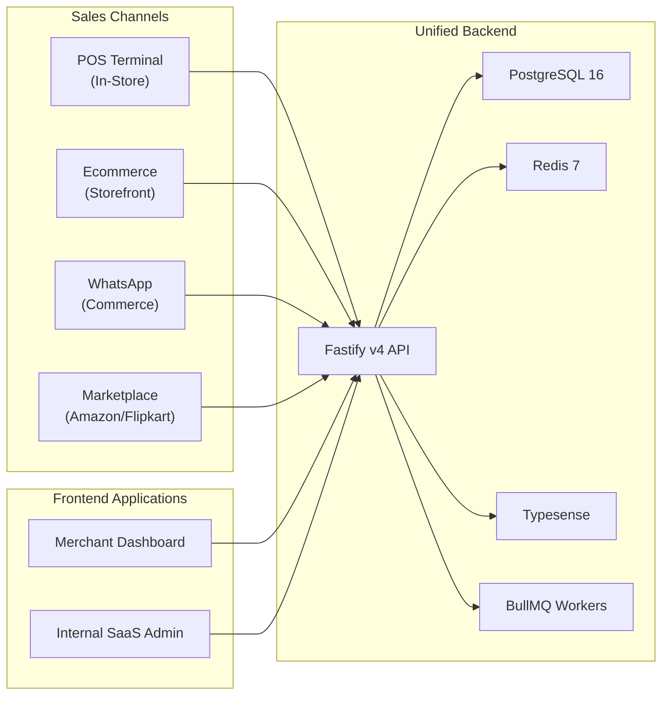
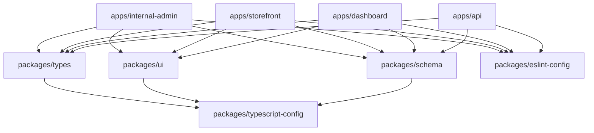
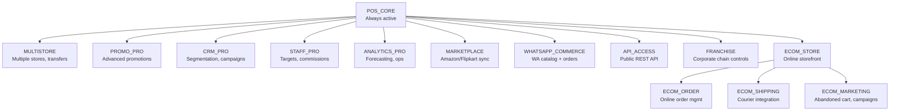
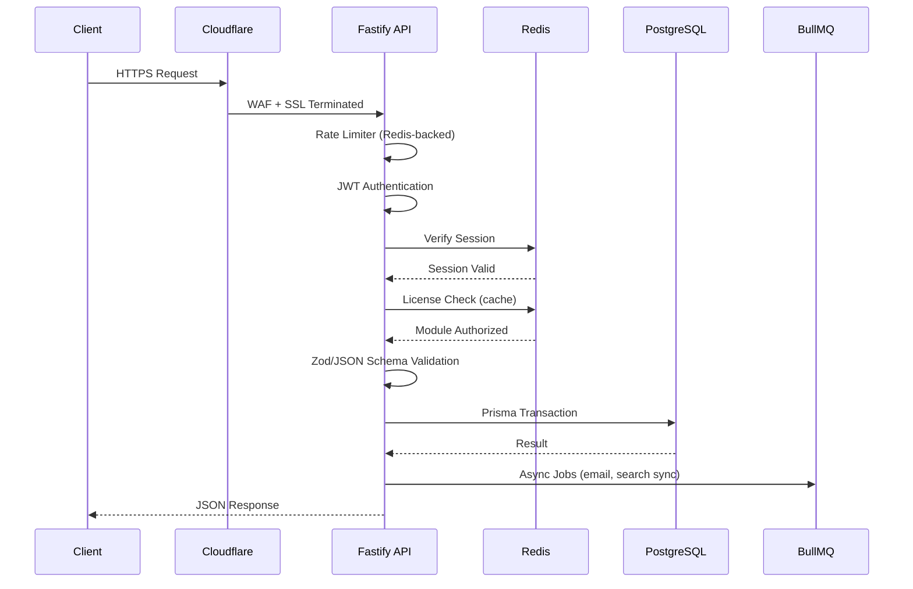
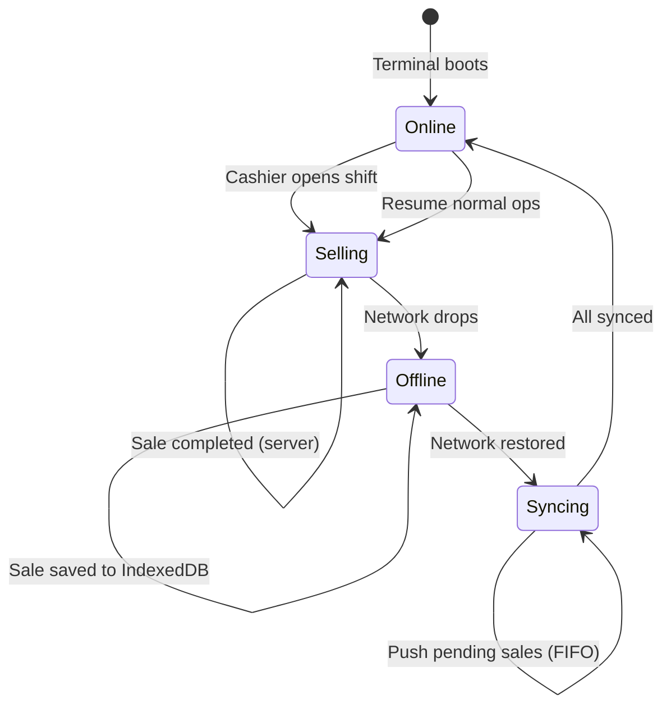
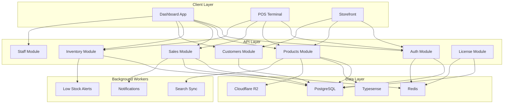
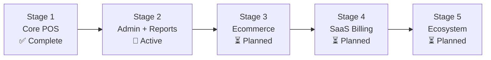

# The Mrktplace

**Enterprise-grade, multi-tenant POS and omnichannel ecommerce SaaS for modern clothing and retail brands.**

Built with Turborepo, Fastify v4, Next.js 14, PostgreSQL 16, Prisma ORM, Redis 7, Typesense, and Tailwind CSS.

---

## Platform Overview



One inventory. One customer database. Every sales channel unified under a single dashboard.

---

## Canonical Documentation

> **Every contributor, engineer, and AI coding agent must read and follow the master documentation in [`docs/`](docs/README.md) before planning or writing any code.**

| Document | What it covers |
|---|---|
| **[System Architecture](docs/system-architecture.md)** | Monorepo topology, Fastify API pipeline, Next.js apps, offline-first POS engine, licensing guard, BullMQ workers, and data flows. |
| **[Design Scheme & Tokens](docs/design-scheme.md)** | TSZ design system: obsidian palette, OKLCH tokens, Inter typography scale, spacing grid, component lifecycle states, and icon conventions. |
| **[Schema Documentation](docs/schema-documentation.md)** | All PostgreSQL/Prisma models, field types, indexes, relations, enums, Zod validation contracts, and offline IndexedDB schema. |
| **[Roadmap & TODOs](docs/todos-and-roadmap.md)** | Five-stage implementation plan with granular checklists tracking every module from POS core to marketplace sync. |
| **[Enhancements & Upgrades](docs/improvisations-and-enhancements.md)** | Modernized libraries, WebUSB/ESC-POS printing, dual-screen displays, distributed inventory locks, and AI-powered search. |
| **[AI Agent Guidelines](docs/ai-agent-guidelines.md)** | Operational rules for AI assistants (Antigravity, Claude, Copilot) and new human contributors joining the project. |
| **[Project Ledger](.agents/project/status.md)** | Tacklestudioz (TSZ) Orchestrator status ledger: locked decisions, assumptions, blockers, and slice progress. |

---

## Repository Structure

```
marketplace/
├── apps/
│   ├── api/                    Fastify v4 REST API + BullMQ workers     :3001
│   ├── dashboard/              Merchant Admin + POS Terminal (Next.js)   :3000
│   ├── storefront/             Customer Ecommerce Storefront (Next.js)  :3002
│   └── internal-admin/         SaaS Control Panel (Next.js)             :3003
│
├── packages/
│   ├── schema/                 Prisma schema, migrations, Zod schemas
│   ├── types/                  Shared TypeScript interfaces and DTOs
│   ├── ui/                     shadcn/ui "radix-maia" component library
│   ├── eslint-config/          Shared linting rules
│   └── typescript-config/      Shared tsconfig base files
│
├── docs/                       Master project documentation (source of truth)
├── .agents/                    TSZ Orchestrator ledger and AI config
├── docker-compose.yml          Local infra (PostgreSQL, Redis, Typesense)
└── turbo.json                  Turborepo pipeline configuration
```

### Package Dependency Graph



---

## Tech Stack

### Backend

| Layer | Technology | Reason |
|---|---|---|
| Runtime | Node.js 22 LTS + TypeScript 5.9 | Stable, high-throughput, full-stack type safety |
| Framework | Fastify v4 | 3x faster than Express, native JSON Schema validation, plugin architecture |
| ORM | Prisma | Best TypeScript integration, clean migrations, readable schema DSL |
| Validation | Zod + Fastify JSON Schema | Dual-layer: Zod for service logic, JSON Schema on route boundaries |
| Auth | @fastify/jwt | JWT handling as a first-class Fastify plugin |
| WebSockets | fastify-socket.io | Reconnection, tenant rooms, Redis adapter for horizontal scaling |
| Job Queue | BullMQ + Redis | Background jobs: emails, search sync, low-stock alerts, report generation |
| File Storage | Cloudflare R2 (S3-compatible) | Zero egress fees, product images, invoice PDFs, shipping labels |
| API Docs | @fastify/swagger | Auto-generated OpenAPI spec from existing route schemas |

### Databases

| Database | Role | Hosting |
|---|---|---|
| PostgreSQL 16 | All transactional data via Prisma ORM | Supabase or AWS RDS |
| Redis 7 | Cache, sessions, BullMQ, rate limits, pub/sub | Upstash (serverless) |
| Typesense | Typo-tolerant product search for POS and storefront | Typesense Cloud or self-hosted |
| TimescaleDB | Time-series analytics events (planned Stage 2) | PostgreSQL extension |
| Cloudflare R2 | All file/blob storage | Cloudflare |

### Frontend

| Layer | Technology | Notes |
|---|---|---|
| Framework | Next.js 14 App Router | SSR for SEO (storefront), SPA for dashboard/POS |
| Styling | Tailwind CSS v3 + OKLCH tokens | Custom design tokens, no raw hex colors |
| Components | shadcn/ui (radix-maia variant) | Copy-paste Radix primitives, zero runtime overhead |
| Icons | @hugeicons/react | Modern, high-fidelity icon set |
| Server State | TanStack Query v5 | Cache, mutations, optimistic updates, background refetch |
| Client State | Zustand v5 | Granular selectors, minimal re-renders during checkout |
| Offline Storage | Dexie.js (IndexedDB) | Product catalog, pending sales, license cache |
| Forms | TanStack Form + Zod | Type-safe forms with schema parity to backend |
| Charts | Recharts | Analytics dashboard visualizations |

### Infrastructure

| Service | Tool | Purpose |
|---|---|---|
| Backend Hosting | Hetzner Cloud CPX31 (2 instances) | 4 vCPU, 8GB RAM, cost-effective |
| Frontend Hosting | Vercel | Zero-config edge CDN deployment |
| CDN + Security | Cloudflare | DNS, SSL, DDoS, WAF, bot protection |
| CI/CD | GitHub Actions | Test, build, push image, deploy on merge |
| Containers | Docker + Docker Compose | Local dev spins up everything in one command |
| Error Tracking | Sentry | Frontend + backend error capture |
| Monitoring | Grafana + Prometheus | Server and application metrics |
| Logs | Grafana Loki | Log aggregation |
| Email | Resend | Transactional and lifecycle emails (React Email templates) |
| SMS | MSG91 | Indian OTPs and campaigns |
| WhatsApp | Meta WABA via Interakt | Indian reseller, good support |
| Payments | Razorpay (India) / Stripe (International) | Subscriptions + one-time payments |

---

## Module & Licensing System

The platform operates on a module-based licensing model. Each tenant subscribes to a plan and can purchase individual add-on modules.



### Pricing

| Plan | Monthly | POS_CORE | MULTISTORE | PROMO_PRO | CRM_PRO | STAFF_PRO | Max Users | Max Products |
|---|---|---|---|---|---|---|---|---|
| **Starter** | ₹999 | Yes | No | No | No | No | 3 | 500 |
| **Professional** | ₹2,999 | Yes | 5 stores | Yes | Yes | Yes | 25 | 5,000 |
| **Enterprise** | ₹7,999 | Yes | 20 stores | Yes | Yes | Yes | Unlimited | Unlimited |

---

## Quickstart

### Prerequisites
- Node.js 22 LTS or higher
- npm 10+
- Docker Desktop (for PostgreSQL, Redis, Typesense)

### Setup

```bash
# 1. Copy environment variables
cp .env.example .env

# 2. Start infrastructure services
docker-compose up -d postgres redis typesense

# 3. Install dependencies and generate Prisma client
npm install
npx prisma migrate dev --schema=packages/schema/src/prisma/schema.prisma

# 4. Launch all applications
npm run dev
```

### Application URLs (Development)

| Application | URL | Description |
|---|---|---|
| Merchant Dashboard + POS | http://localhost:3000 | Admin panel and full-screen billing terminal |
| Fastify API Server | http://localhost:3001 | REST API and background workers |
| Ecommerce Storefront | http://localhost:3002 | Customer-facing online shop |
| Internal SaaS Admin | http://localhost:3003 | Platform control panel and licensing |

---

## Development Workflow

### Key Commands

```bash
npm run dev          # Start all apps in development mode (Turbo)
npm run build        # Production build of all apps
npm run lint         # Lint all workspaces
npm run typecheck    # TypeScript type checking across all packages
npm run format       # Format with Prettier + Tailwind plugin
```

### Adding shadcn/ui Components

```bash
# Add to dashboard app
npx shadcn@latest add button -c apps/dashboard

# Add to storefront app
npx shadcn@latest add card -c apps/storefront
```

Components are placed in `packages/ui/src/components/` and shared across all frontend apps via the `@workspace/ui` import.

### Database Workflow

```bash
# Apply schema changes (development)
npx prisma migrate dev --schema=packages/schema/src/prisma/schema.prisma

# Push schema without migration (prototyping)
npx turbo run db:push --filter=@themrktplace/schema

# Open Prisma Studio
npx prisma studio --schema=packages/schema/src/prisma/schema.prisma
```

---

## Architecture Overview

### Request Lifecycle



### Offline POS Sync Flow



### Data Flow Between Apps



---

## Stage Progression



Each stage generates revenue that funds the next. See [docs/todos-and-roadmap.md](docs/todos-and-roadmap.md) for the full breakdown.

---

## Contributing

1. Read the full documentation suite in [`docs/`](docs/README.md) before touching any code.
2. Follow the module architecture: `modules/{domain}/{components,hooks,store,types,utils}`.
3. No business logic in page files. Pages only compose module components.
4. All server state through TanStack Query hooks. No raw `fetch()` in components.
5. Every form uses TanStack Form + Zod with schema parity to the backend.
6. Destructive actions require `AlertDialog` confirmation. No `window.confirm()`.
7. Use semantic OKLCH tokens for all colors. No hardcoded hex values.
8. Use `@hugeicons/react` for all icons. No other icon libraries.

---

## License

Private. All rights reserved.
