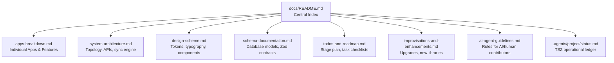
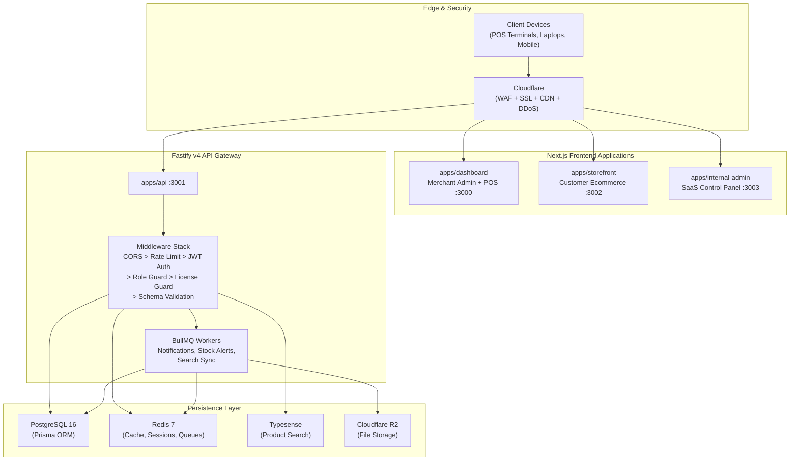

# The Mrktplace: Master Engineering Documentation

Welcome to **The Mrktplace**, an enterprise-grade, multi-tenant omnichannel POS and ecommerce SaaS platform purpose-built for modern clothing and retail businesses.

---

## Documentation Index

> **Rule**: Every developer, contributor, and AI coding agent working on this project **must read and adhere strictly** to the documents indexed below before planning or writing any code.



| Document | Description | Primary Audience |
| --- | --- | --- |
| [Apps Architecture & Features](apps-breakdown.md) | Exhaustive breakdown of each individual app (`api`, `dashboard`, `storefront`, `internal-admin`) and shared packages. | All Engineers & Contributors |
| [System Architecture](system-architecture.md) | High-level topology, monorepo packages, Fastify API pipeline, Next.js apps, offline-first sync engine, licensing guard, BullMQ workers, and data flows. | Backend / Fullstack / DevOps |
| [Design Scheme & Tokens](design-scheme.md) | Complete TSZ design system: luxury obsidian palette, OKLCH tokens, typography scale, spacing grid, component lifecycle states, and icon conventions. | UI / Frontend / Design |
| [Schema Documentation](schema-documentation.md) | Exhaustive reference of all PostgreSQL Prisma tables, field types, indexes, relational constraints, Zod validation contracts, and offline IndexedDB schema. | Fullstack / Backend / DBA |
| [TODOs & Roadmap](todos-and-roadmap.md) | Five-stage implementation plan (Stages 1 to 5), tracking completed milestones, active work items, and upcoming deliverables with granular checklists. | Project Lead / Contributors |
| [Enhancements & Upgrades](improvisations-and-enhancements.md) | Modernized libraries, technical terms, architectural upgrades, hardware integration (WebUSB, ESC/POS, dual-screen), and AI-powered search. | Architects / Engineers |
| [AI Agent Guidelines](ai-agent-guidelines.md) | Mandatory operational protocol and reference rules for AI assistants (Antigravity, Claude, Copilot) and new human contributors joining the project. | AI Agents / New Contributors |
| [Project Ledger](../.agents/project/status.md) | Current operational ledger following the Tacklestudioz (TSZ) Orchestrator protocol. | All contributors |

---

## Platform Architecture at a Glance



---

## Repository Structure

```
marketplace/
├── apps/
│   ├── api/                    Fastify v4 REST API + BullMQ workers     :3001
│   │   ├── src/middleware/     Authentication, authorization, license guard
│   │   ├── src/modules/       Domain modules (auth, products, sales, inventory...)
│   │   ├── src/workers/       Background job processors
│   │   └── src/lib/           Prisma client, Redis, BullMQ, Typesense, R2
│   │
│   ├── dashboard/              Merchant Admin + POS Terminal (Next.js)   :3000
│   │   ├── app/(auth)/        Login, register, verify-email
│   │   ├── app/(dashboard)/   Inventory, sales, customers, staff, reports, settings
│   │   ├── app/(pos)/         Full-screen POS billing terminal
│   │   └── modules/           Domain modules (pos, inventory, sales, auth, onboarding...)
│   │
│   ├── storefront/             Customer Ecommerce Storefront (Next.js)  :3002
│   └── internal-admin/         SaaS Control Panel (Next.js)             :3003
│
├── packages/
│   ├── schema/                 Prisma schema, migrations, Zod validation schemas
│   ├── types/                  Shared TypeScript interfaces and DTOs
│   ├── ui/                     shadcn/ui "radix-maia" component library (60+ components)
│   ├── eslint-config/          Shared ESLint configuration
│   └── typescript-config/      Shared tsconfig base files
│
├── docs/                       Master documentation (you are here)
├── .agents/                    TSZ Orchestrator ledger and AI configuration
├── docker-compose.yml          Local infrastructure (PostgreSQL, Redis, Typesense)
└── turbo.json                  Turborepo pipeline configuration
```

---

## Quickstart

### Prerequisites
- Node.js version 22 LTS or higher
- npm version 10 or higher
- Docker Desktop (for PostgreSQL, Redis, Typesense)

### Setup Commands
```bash
# 1. Copy environment variables
cp .env.example .env

# 2. Start infrastructure services
docker-compose up -d postgres redis typesense

# 3. Install dependencies and generate Prisma client
npm install
npx prisma migrate dev --schema=packages/schema/src/prisma/schema.prisma

# 4. Launch all applications
npm run dev
```

### Application URLs
| App | URL | Description |
|---|---|---|
| Dashboard + POS | http://localhost:3000 | Merchant admin and full-screen billing terminal |
| API Server | http://localhost:3001 | REST API and background workers |
| Storefront | http://localhost:3002 | Customer-facing online shop |
| Internal Admin | http://localhost:3003 | Platform control panel and licensing |

---

## Core Operating Principles

1. **Think Before Building**: No code until the requirements, schemas, and slice plans in `docs/` are locked.
2. **Strict Module Architecture**: Features must be encapsulated in modular boundaries (`modules/{domain}/components`, `hooks`, `store`, `types`, `utils`).
3. **Type Parity**: Strict TypeScript across all apps. Every form and API route shares validated Zod schemas from `packages/schema`.
4. **Docs are the Source of Truth**: When in doubt, the answer is in `docs/`. If not, add it.
5. **Human-Grade Code**: Everything written must look and feel like work from an experienced senior engineer and a tasteful product designer.
