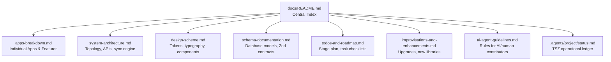
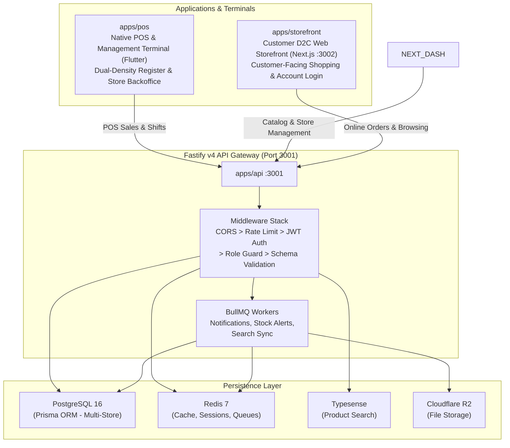

# The Mrktplace: Master Engineering Documentation

Welcome to **The Mrktplace**, an enterprise-grade standalone omnichannel POS and ecommerce retail suite purpose-built for modern clothing and apparel brands.

---

## Documentation Index

> **Rule**: Every developer, contributor, and AI coding agent working on this project **must read and adhere strictly** to the documents indexed below before planning or writing any code.



| Document | Description | Primary Audience |
| --- | --- | --- |
| [Apps Architecture & Features](apps-breakdown.md) | Exhaustive breakdown of each individual app (`pos` Flutter, `storefront` Next.js, `api` Fastify) and shared packages. | All Engineers & Contributors |
| [System Architecture](system-architecture.md) | High-level standalone topology, Fastify API pipeline, Flutter POS engine, Next.js storefront, and data flows. | Backend / Fullstack / Mobile |
| [Design Scheme & Tokens](design-scheme.md) | Complete TSZ design system: luxury obsidian palette, OKLCH tokens, typography scale, spacing grid, and component states. | UI / Frontend / Design |
| [Schema Documentation](schema-documentation.md) | Reference of all PostgreSQL Prisma tables, field types, indexes, relational constraints, Zod validation contracts, and offline schema. | Fullstack / Backend / DBA |
| [TODOs & Roadmap](todos-and-roadmap.md) | Implementation plan tracking completed milestones, active work items, and upcoming deliverables with granular checklists. | Project Lead / Contributors |
| [Enhancements & Upgrades](improvisations-and-enhancements.md) | Modernized libraries, technical terms, hardware integration (WebUSB/Bluetooth, ESC/POS, dual-screen), and AI search. | Architects / Engineers |
| [AI Agent Guidelines](ai-agent-guidelines.md) | Mandatory operational protocol and reference rules for AI assistants and contributors joining the project. | AI Agents / New Contributors |
| [Project Ledger](../.agents/project/status.md) | Current operational ledger following the Tacklestudioz (TSZ) Orchestrator protocol. | All contributors |

---

## Standalone Platform Architecture at a Glance



---

## Repository Structure

```
marketplace/
├── apps/
│   ├── pos/                    Native Retail POS & Management Terminal (Flutter 3.x)
│   │   ├── lib/main.dart      App entry, terminal shell, and management mode
│   │   └── lib/src/           Core (network, database, hardware), POS features, & Store/Web Management
│   │
│   ├── storefront/             Customer D2C Web Storefront (Next.js 14)  :3002
│   │   └── app/               Customer catalog, shopping bag, checkout, and customer login
│   │
│   └── api/                    Fastify v4 REST API + BullMQ workers     :3001
│       ├── src/middleware/     Authentication, authorization, rate limiting
│       ├── src/modules/       Domain modules (auth, products, sales, inventory, shifts, website...)
│       ├── src/workers/       Background job processors (notifications, search sync)
│       └── src/lib/           Prisma client, Redis, BullMQ, Typesense, R2
│
├── packages/
│   ├── schema/                 Prisma schema, migrations, Zod validation schemas
│   ├── types/                  Shared TypeScript interfaces and DTOs
│   ├── ui/                     shadcn/ui "radix-maia" component library
│   ├── eslint-config/          Shared ESLint configuration
│   └── typescript-config/      Shared tsconfig base files
│
├── docs/                       Master documentation (you are here)
├── .agents/                    TSZ Orchestrator ledger and AI configuration
├── docker-compose.yml          Local infrastructure (PostgreSQL, Redis, Typesense)
└── turbo.json                  Turborepo pipeline configuration
```

---

## Quickstart

### Prerequisites
- Node.js version 22 LTS or higher
- npm version 10 or higher
- Flutter SDK (for POS application)
- Docker Desktop (for PostgreSQL, Redis, Typesense)

### Setup Commands
```bash
# 1. Copy environment variables
cp .env.example .env

# 2. Start infrastructure services
docker-compose up -d postgres redis typesense

# 3. Install web dependencies
npm install

# 4. Generate Prisma database client
npx prisma generate --schema=packages/schema/src/prisma/schema.prisma

# 5. Launch web services (API and Storefront)
npm run dev

# 6. Launch Flutter POS & Management Terminal
cd apps/pos
flutter run
```

### Application URLs & Ports
| App | Target / URL | Description |
|---|---|---|
| POS & Management Terminal | Native App / Tablet / Desktop | Native Flutter POS billing & store management |
| Fastify API Server | http://localhost:3001 | REST API and background workers |
| Ecommerce Storefront | http://localhost:3002 | Customer-facing online brand shop |
