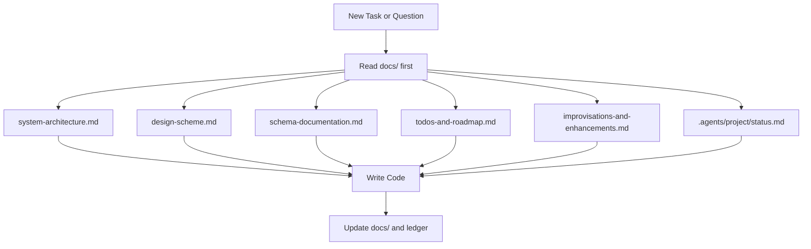
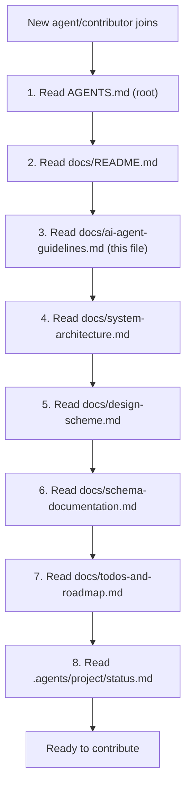
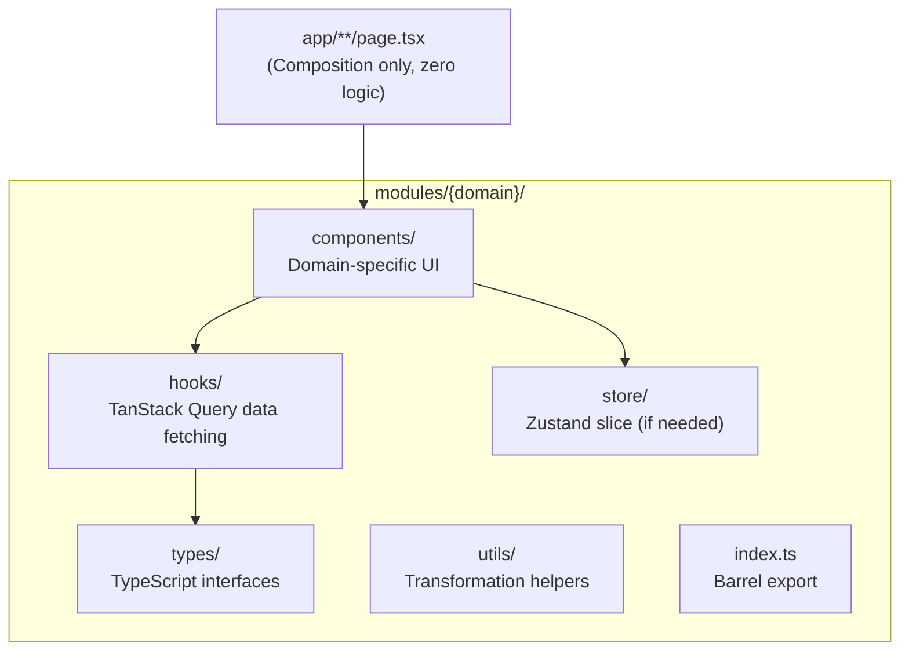
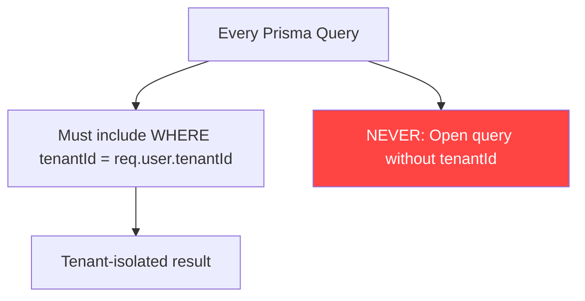
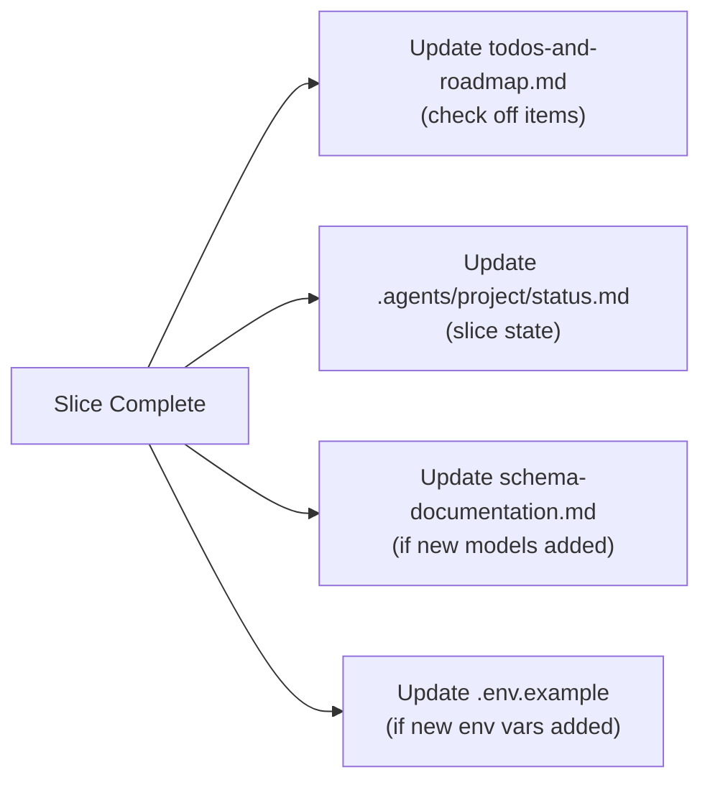

# AI Agent & Contributor Operational Protocol

This document establishes mandatory guidelines for any AI coding assistant (Google Antigravity, Claude Code, GitHub Copilot, Cursor) or human developer working within this repository.

---

## 1. Prime Directive: Documentation is the Source of Truth



**Every AI assistant operating on this repository must read from and conform to the `docs/` directory before proposing or executing code changes.**

| Question | Reference Document |
|---|---|
| What database models exist? | [`docs/schema-documentation.md`](schema-documentation.md) |
| What colors/tokens/fonts to use? | [`docs/design-scheme.md`](design-scheme.md) |
| How is the system structured? | [`docs/system-architecture.md`](system-architecture.md) |
| What needs to be built next? | [`docs/todos-and-roadmap.md`](todos-and-roadmap.md) |
| What modern libraries are planned? | [`docs/improvisations-and-enhancements.md`](improvisations-and-enhancements.md) |
| What is the current project state? | [`.agents/project/status.md`](../.agents/project/status.md) |

---

## 2. Code Quality & TSZ Anti-Slop Rules

All generated code, comments, documentation, and commit proposals must follow the **TSZ Anti-Slop Standard**:

1. **No em dashes**: Never use em dashes in prose, copy, comments, documentation, or commit messages. Use colons, commas, or full stops.
2. **No robotic boilerplate**: Avoid generic commentary (e.g. `// Here we handle the click event`). Write clean, self-explanatory code with concise JSDoc where logic is complex.
3. **No decorative placeholders**: Do not inject placeholder dummy data, fake testimonials, or incomplete `TODO: implement later` blocks without explicit instructions.
4. **Clickable links**: When referencing files or code symbols in conversation, provide clickable markdown links using the `file:///` scheme.
5. **Signature check**: Code should exhibit at least three deliberate decisions that could not come from a template: a type pairing, a layout rule, a color relationship, a distinctive interaction, or a real treatment.

---

## 3. Onboarding Checklist for New Agents/Contributors



---

## 4. Frontend Architecture Rules

### 4.1 Module Architecture



**Rules**:
- Every domain feature lives inside `modules/{domain}/`.
- Page files (`app/**/page.tsx`) contain **zero business logic**. They only import and compose module components.
- All server state through typed **TanStack Query** hooks. Raw `fetch()` or direct Axios calls in components are forbidden.
- Forms must use **TanStack Form** + **Zod** + `@workspace/ui/components/field`.

### 4.2 UI & Design System

| Rule | Enforcement |
|---|---|
| Component library | shadcn/ui "radix-maia" variant only |
| Styling | Tailwind CSS v3 using OKLCH semantic tokens. No inline styles. No raw hex colors. |
| Icons | `@hugeicons/react` only. No Lucide, no Heroicons, no other sets. |
| Dark mode | Every component must support both dark and light via `next-themes` |
| Loading states | `Skeleton` for layout, `Spinner` for inline. Never blank screen. |
| Empty states | Centered: outline icon + title + description + CTA button |
| Destructive actions | `AlertDialog` confirmation with consequence text. No `window.confirm()` |
| Notifications | `Sonner` (shadcn/ui toaster) for all messages |

---

## 5. Backend & Database Rules

### 5.1 Multi-Tenant Isolation



**Rules**:
- Every Prisma query across business domains **must** include `where: { tenantId }`.
- Financial numbers use `Decimal(12, 2)`. Never floating point for money.
- Every inventory modification occurs inside a Prisma `$transaction` that creates an immutable `inventory_movements` record.
- Protected routes must declare required module code with `license-guard` middleware.

---

## 6. Documentation Maintenance Contract

When an AI assistant or contributor completes or advances a work slice:



1. Update [`docs/todos-and-roadmap.md`](todos-and-roadmap.md) to check off completed items.
2. Update [`.agents/project/status.md`](../.agents/project/status.md) slice status.
3. If new models or environment variables were introduced, document them in [`docs/schema-documentation.md`](schema-documentation.md) and `.env.example`.
4. If new design tokens or components were added, update [`docs/design-scheme.md`](design-scheme.md).

---

## 7. Commit Message Format

```
<scope>: <short description>

scope = auth | inventory | sales | pos | crm | staff | reports | settings | schema | ui | infra | docs
```

Examples:
- `sales: add split payment support for UPI and store credit`
- `schema: add StockTransfer model and migration`
- `pos: implement WebUSB ESC/POS receipt printing`
- `docs: update roadmap with Stage 2 analytics checklist`

No em dashes in commit messages. No generic phrases like "various improvements" or "minor fixes."
