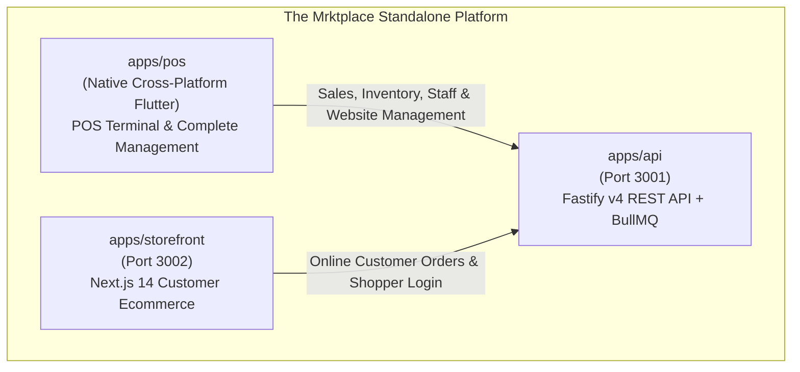
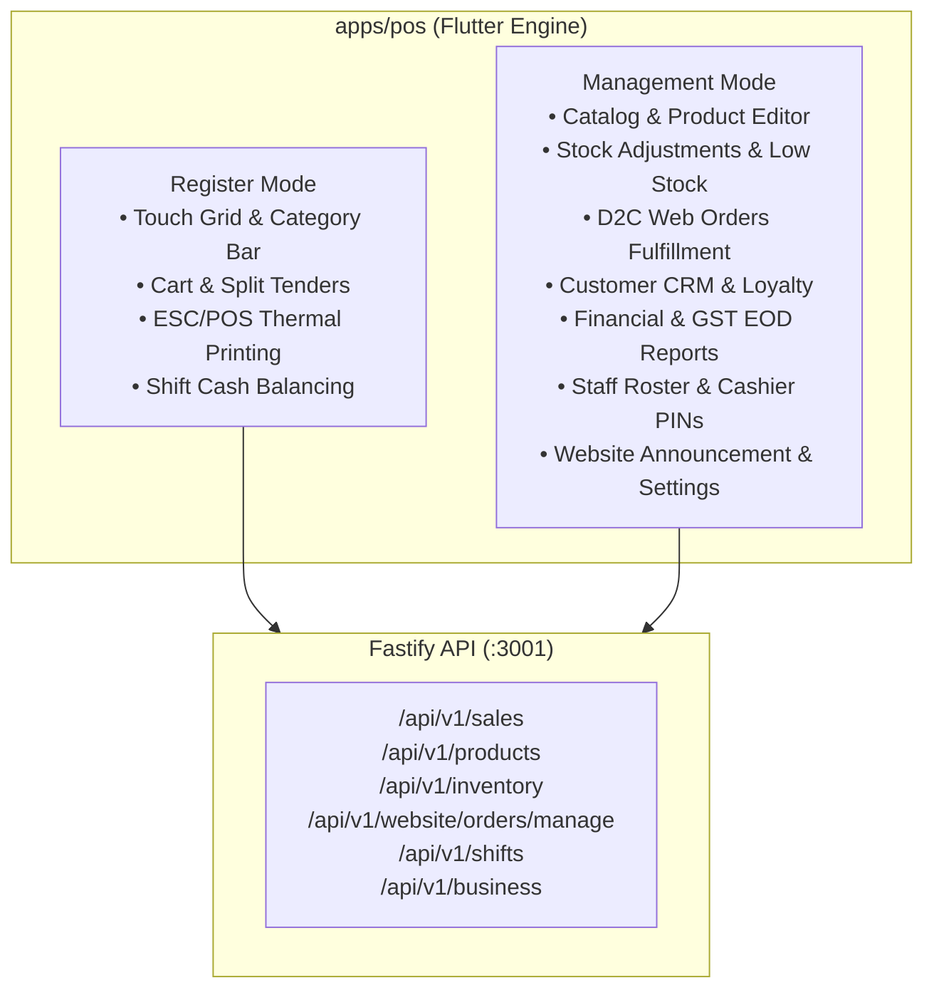

# Applications Architecture & Feature Breakdown (Standalone Omnichannel Retail)

themrktplace platform is engineered as a streamlined standalone omnichannel retail suite for apparel and modern retail brands, comprising two primary application frontends, one central backend service, and four shared packages.

---

## Application Overview Matrix

| Application | Technology | Target Devices | Primary Role |
|---|---|---|---|
| **`apps/pos`** | Flutter 3.x, Riverpod, Drift (SQLite), ESC/POS | Android Tablets, iPads, Windows POS registers | Combined Retail Billing Terminal and Central Store/Website Management Application. All catalog, stock, web orders, and brand settings are managed here. |
| **`apps/storefront`** | Next.js 14 App Router (SSR), Tailwind, shadcn/ui | Mobile & Desktop Web Shoppers | Branded customer-facing online ecommerce store. Authentication is strictly for customer accounts (order tracking, loyalty rewards, store credit). |
| **`apps/api`** | Fastify v4, Prisma ORM, Redis 7, BullMQ, Typesense | Linux / Docker / Cloud (Port 3001) | Central REST API gateway, database transaction orchestrator, and background worker processor. |

---

## 1. `apps/pos`: Flutter Native POS & Management Terminal

A native cross-platform application purpose-built for counter checkout performance on touchscreen registers, which also doubles as the **complete management backoffice** for the retail store and online website.

### Key Capabilities

#### Register Mode (Checkout Counter)
1. **Touch & Keyboard Optimization**: Full-screen tactical grid layout designed for 10-inch tablets and desktop POS setups with zero unwanted scrolling.
2. **Catalog Discovery & Barcode Scanner**: Instant category filtering, real-time stock indicators, and hardware USB/Bluetooth barcode scanner HID listening directly into the cart.
3. **Split Tender Payments**: Multi-channel checkout allowing customers to split payment across Cash, dynamic UPI QR, Credit/Debit cards, Loyalty points, and Store credit in a single order.
4. **Shift & Cash Drawer Management**: Shift open cash float entry and end-of-shift cash counting with automated discrepancy calculations (`closing - (opening + cash_sales)`).
5. **Quick PIN Terminal Lock**: 4-digit PIN authentication enabling cashiers to lock and unlock the register between customers in 2 seconds.
6. **Direct ESC/POS Thermal Printing**: Raw binary ESC/POS communication over USB, Bluetooth, or Ethernet for instant (< 200ms) receipt printing and automatic cash drawer kick.
7. **Offline-First Resilience**: Full product catalog and price list cached locally in SQLite. If network drops, sales continue seamlessly and auto-sync chronologically upon reconnect.

#### Management Mode (Store & Website Control)
1. **Catalog & Product Management**: Create and edit apparel products, configure size and color variant matrices, adjust prices, and toggle whether an item is live on the customer website.
2. **Physical Stock Adjustments**: Fast stock correction dialog with movement reasons (`DAMAGE`, `RECOUNT`, `RETURN`, `STORE_USE`).
3. **Omnichannel Web Orders**: Real-time monitor of online customer orders from `apps/storefront`. Update order status (`PACKED`, `SHIPPED`, `DELIVERED`), and verify in-store BOPIS pickups.
4. **Customer CRM**: Search customers by phone or email, inspect order history, check reward points, and view available store credit balances.
5. **Reports & GST**: End-of-day register closure reports, tender method breakdowns, staff commission rankings, and GSTR-1 compliant CSV export.
6. **Staff PIN Setup**: Assign staff roles (`OWNER`, `MANAGER`, `CASHIER`) and set 4-digit PINs for terminal access.
7. **Website Settings**: Configure top announcement banners, featured collection titles, contact information, and toggle website storefront live status.

---

## 2. `apps/storefront`: Customer Ecommerce Website

- **Port**: `3002`
- **Location**: [`apps/storefront/`](file:///d:/Personal/marketplace/apps/storefront)
- **Role**: Customer-facing online ecommerce store built with Next.js 14 App Router and Server-Side Rendering (SSR).
- **Authentication**: **Customer-only login**. No administrative or staff controls exist on the website.

### Key Capabilities
- **Apparel Catalog Discovery**: Server-side rendered category pages with client-side faceted filtering (Category, Size, Color, Price Range, In-Stock only).
- **Product Detail & Size Selector**: High-resolution image galleries, interactive Size x Color variant matrix selector, real-time physical store availability indicators, and apparel size charts.
- **Customer Account Portal (`/account`)**: Strictly for customers to track order fulfillment status, monitor loyalty point balances, and check store credit from returns.
- **Customer Sign In & Registration (`/login`, `/register`)**: Customer account creation with phone, email, and password.
- **Omnichannel Checkout (`/checkout`)**: Multi-step checkout with address validation, Indian pincode courier validation, and payment via Razorpay or Cash on Delivery.
- **Click & Collect (BOPIS)**: Option for customers to purchase online and pick up at the retail store counter.

---

## 3. `apps/api`: Fastify v4 Backend & Worker Service

- **Port**: `3001`
- **Location**: [`apps/api/`](file:///d:/Personal/marketplace/apps/api)
- **Role**: Central REST API gateway, database transaction orchestrator, and background worker processor.

### Module Breakdown
- **`modules/auth`**: User/staff registration, email/password login, JWT access/refresh token rotation, quick POS PIN authentication, active session tracking.
- **`modules/products`**: Products, categories, clothing variant matrix, price lists, Typesense search indexing.
- **`modules/inventory`**: Stock levels per store, inventory movements, purchase orders, low-stock threshold monitoring.
- **`modules/sales`**: Multi-tender sales, split payment processing, returns/refunds, ESC/POS invoice generation, held/parked carts.
- **`modules/customers`**: Customer profiles, loyalty point logs, store credit ledgers.
- **`modules/shifts`**: Cashier shift open/close reconciliation, cash denomination calculations, discrepancy tracking.
- **`modules/business`**: Brand settings, store branch locations, tax configuration.
- **`modules/website`**: Customer authentication, public website catalog, customer online order placement, and POS order fulfillment management.
- **`workers/`**: BullMQ background workers for email notifications (Resend), SMS notifications (MSG91), and inventory alerts.
