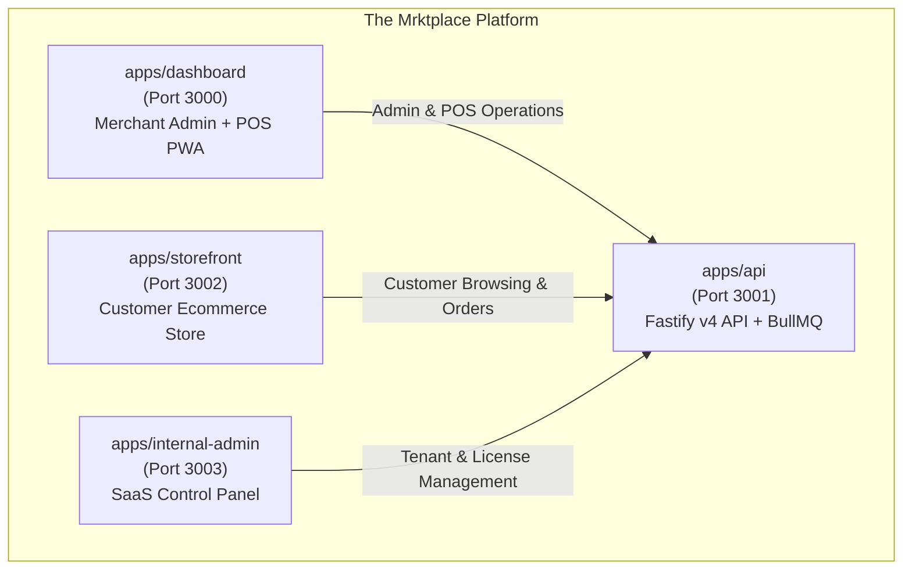
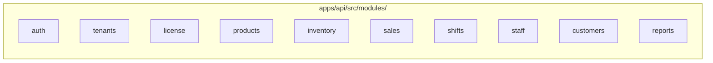
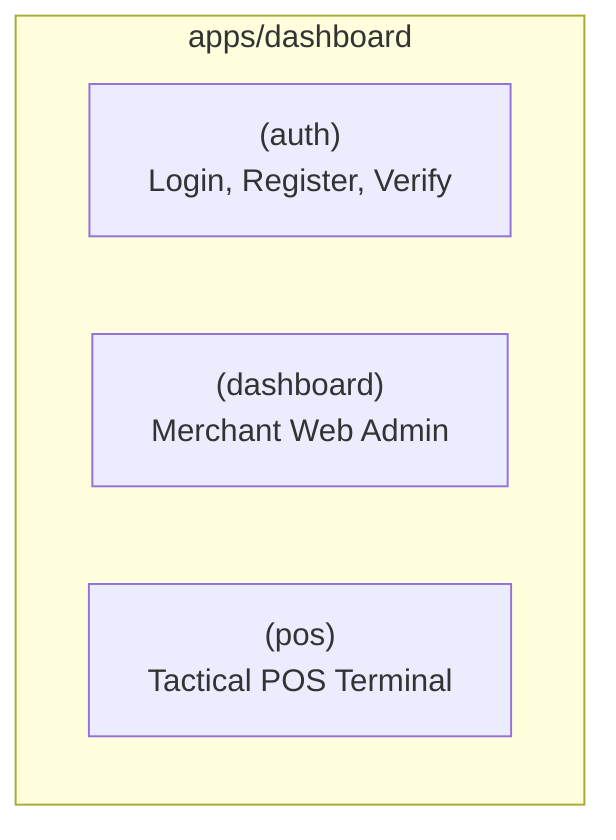
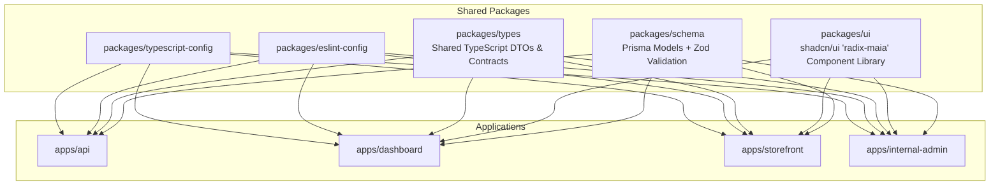

# Applications Architecture & Feature Breakdown

The Mrktplace platform consists of four distinct applications and five shared packages orchestrated within a Turborepo monorepo.

---

## 🏛️ Application Overview Matrix

| Application | Port | Technology | Primary Users | Primary Role |
|---|---|---|---|---|
| **`apps/api`** | `3001` | Fastify v4, Prisma ORM, BullMQ, Redis, Typesense | All frontends | Central multi-tenant REST API gateway and asynchronous background worker host. |
| **`apps/dashboard`** | `3000` | Next.js 14 App Router, shadcn/ui, Zustand, Dexie.js | Store Owners, Store Managers, Cashiers | Dual-purpose portal: Merchant web administration dashboard AND full-screen retail POS billing terminal. |
| **`apps/storefront`** | `3002` | Next.js 14 App Router (SSR), Tailwind CSS, shadcn/ui | Retail End-Customers | Branded customer-facing online ecommerce store sharing real-time inventory with the POS. |
| **`apps/internal-admin`** | `3003` | Next.js 14 App Router, shadcn/ui, TanStack Query | SaaS Founders & Platform Ops | Central SaaS control room for tenant provisioning, license generation, and MRR metrics. |

---

## 1. `apps/api` — Fastify Backend & Worker Service

The core engine of the platform, built with **Fastify v4** for extreme JSON throughput, strict type safety, and decoupled asynchronous job processing.

### What It Does
- Exposes secure, multi-tenant REST API endpoints consumed by all frontend applications.
- Enforces tenant isolation, role-based authorization, and modular feature licensing.
- Hosts background BullMQ workers for notifications, search indexation, and stock tracking.
- Maintains transactional ACID integrity for financial records, stock movements, and shift accounts.

### Module-by-Module Feature Breakdown

| Module | Location | Detailed Features & Capabilities |
|---|---|---|
| **Auth** | `src/modules/auth/` | • Tenant owner registration with transactional store provisioning. • Email/password authentication with bcrypt hashing (work factor 12). • JWT access token issuance (15min) and secure refresh token cookie rotation (7/30 days). • Quick 4-6 digit POS cashier PIN login. • Email verification tokens (Resend) and SMS OTP generation (MSG91). • Active session revocation and remote logout of rogue devices. • Rate limiting (5 failed attempts per 10 min locks account for 15 min). |
| **Tenants** | `src/modules/tenants/` | • Business profile management (legal name, GSTIN, currency, address). • Store location CRUD (Retail Store, Warehouse, Pop-up). • 6-step onboarding wizard progress synchronization. • Receipt customization (headers, footers, tax inclusive/exclusive). |
| **License** | `src/modules/license/` | • Fastify `license-guard` middleware verifying active module flags. • Redis caching of tenant permissions (`license:{tenant_id}`, TTL: 1 hr). • Cryptographic license key redemption and bcrypt verification. • Device fingerprint binding and active terminal registration. • Audit trail logging for license upgrades, renewals, and locks. |
| **Products** | `src/modules/products/` | • Root apparel product definition with categories and HSN codes. • Dynamic apparel variant matrix generation (Size x Color combinations). • Automatic SKU and barcode generation and lookup. • Image asset association via Cloudflare R2. • Real-time search index push to Typesense/Meilisearch. |
| **Inventory** | `src/modules/inventory/` | • Multi-store stock level tracking per variant. • Atomic stock adjustments inside Prisma `$transaction`. • Append-only `inventory_movements` ledger for full audit traceability. • Low stock threshold alert triggers. • Purchase order creation, supplier tracking, and stock intake. |
| **Sales** | `src/modules/sales/` | • Rapid checkout invoice generation with sequence numbering. • Line-item and order-level discount and tax calculations (GST/CGST/SGST/IGST). • Split tender payment processing (Cash, Card, UPI, Store Credit, Loyalty Points). • Return and exchange processing with automatic stock restock. • Transient cart parking/holding stored in Redis. |
| **Shifts** | `src/modules/shifts/` | • Cashier shift opening with opening cash float recording. • Shift closing with physical cash drawer count entry. • Automated register discrepancy calculation (`closing - (opening + cash_sales)`). • Detailed shift audit logs for store managers. |
| **Staff** | `src/modules/staff/` | • Employee directory and store location assignment. • Role assignment (`OWNER`, `MANAGER`, `CASHIER`). • POS terminal PIN assignment and bcrypt hashing. • Sales commission tracking and performance metrics. |
| **Customers** | `src/modules/customers/` | • Customer CRM profiles identified uniquely by phone/email. • Total spend, total order count, and visit frequency tracking. • Loyalty points earning rules and redemption tracking. • Store credit balance management from returned merchandise. |
| **Reports** | `src/modules/reports/` | • Day-end summary calculations (revenue, orders, payment splits). • Category and top-selling variant performance aggregations. • Staff sales and commission leaderboards. • GSTR-1 compliant tax breakdown exports. |

### Background Workers (`apps/api/src/workers/`)
- **`notifications.worker.ts`**: Asynchronously dispatches transactional emails via Resend and SMS alerts/OTPs via MSG91 without blocking HTTP response times.
- **Stock Alert Worker**: Evaluates stock levels post-sale and dispatches warnings when inventory drops below `lowStockAlert`.
- **Search Sync Worker**: Streams product updates to Typesense in near real-time.

---

## 2. `apps/dashboard` — Merchant Admin & POS Terminal PWA

A high-performance **Next.js 14** web application serving two distinct operational experiences through route grouping.

### 2.1 The POS Terminal (`/(pos)/pos`)
Designed for full-screen operation on touchscreen tablets (iPad/Android) and counter laptops:
- **`PosTerminal`**: Unified zero-scroll, dual-density checkout interface.
- **`CategorySidebar` & `ProductGrid`**: Quick-access apparel categories, touch product cards, and hardware barcode scanner HID listener (scans directly into cart).
- **`PosCart`**: Real-time line item quantity modifiers, line-level discount overrides, total order discounts, and transaction parking (held carts).
- **`PaymentModal`**: Split tender interface allowing payments across Cash, UPI QR, Credit/Debit cards, Loyalty points, and Store credit in a single transaction.
- **`ShiftManager`**: Shift float entry upon shift start and physical cash counting with automated discrepancy calculations on shift end.
- **`LockScreen`**: Rapid 4-digit PIN authentication enabling cashiers to lock/unlock the register between customers without logging out of the merchant account.
- **Offline Sync Engine (`useSync.ts` + Dexie.js)**: Replicates catalog to IndexedDB locally. Sales made during internet outages are saved offline (`synced: false`), receipt printed locally, and queued for automatic FIFO synchronization once connection is restored.

### 2.2 The Merchant Admin Panel (`/(dashboard)/*`)
Designed for store owners and managers to run retail operations from desktop/laptop browsers:
- **Executive BI Overview (`/`)**: Real-time KPI summary cards (Today's Revenue, Transactions, Average Order Value, Low Stock Alerts) and recent orders.
- **Onboarding Wizard (`/onboarding`)**: 6-step business provisioning wizard with persistent home widget (`OnboardingProgressWidget`) tracking profile, store, staff, catalog, and payment readiness.
- **Inventory Ledger (`/inventory`)**: Rich data table with sorting, search, category filters, clothing variant matrices, manual stock adjustment modals, and low-stock indicators.
- **Sales & Invoices (`/sales`)**: Historical transaction browser, detailed order breakdown sheets, return/refund processors, and thermal receipt re-printers.
- **Customer CRM (`/customers`)**: Customer directory, contact cards, lifetime spend, loyalty point balances, and store credit logs.
- **Staff Management (`/staff`)**: Employee list, role assignment, POS PIN setup, active shift monitoring, and commission summaries.
- **Reports & Analytics (`/reports`)**: Interactive Recharts visualizations (revenue trends, sales by category, hourly heatmaps), and GSTR-1 export tools.
- **Store Settings (`/settings`)**: Business profile editor, store branch configuration, GST rates, payment method toggles, and module license upgrade manager (`LicenseBanner`).

---

## 3. `apps/storefront` — Customer Ecommerce Storefront

A customer-facing **Next.js 14 App Router** ecommerce application with Server-Side Rendering (SSR) for search engine indexing.

### What It Does
- Enables retail merchants to sell apparel online while sharing the exact same product catalog, pricing, and stock levels as their physical POS.
- Eliminates inventory discrepancies between in-store sales and online purchases.

### Feature Breakdown
- **Multi-Tenant Subdomain Routing**: Dynamic routing serving merchant stores via custom subdomains (e.g. `merchantslug.mrktplace.com`).
- **Apparel Catalog Discovery**: Server-side rendered category pages with instant client-side faceted filtering (Category, Size, Color, Price Range, In-Stock only).
- **Product Detail Page (PDP)**: High-resolution image galleries, interactive Size x Color variant selector matrix, real-time store availability check, and apparel size charts.
- **Cart & Wishlist**: Persistent cart state with real-time stock availability verification.
- **Stock Reservation Engine**: Redis-backed 10-minute temporary stock locks during online checkout to prevent concurrent in-store overselling.
- **Omnichannel Checkout**: Multi-step checkout with address validation, Indian pincode delivery serviceability, and online payment via Razorpay (UPI, Cards, Net Banking, COD).
- **Click & Collect (BOPIS)**: Option for customers to purchase online and select in-store pickup at a specific physical store branch.
- **Customer Portal**: Order tracking, invoice download, past order history, and loyalty points display.

---

## 4. `apps/internal-admin` — SaaS Platform Control Panel

An isolated **Next.js 14** application designed exclusively for the SaaS founders, platform engineers, and support staff.

### What It Does
- Serves as the central mission control to manage tenant merchants, subscriptions, system health, and software licensing.
- Completely separated from merchant dashboards for security and operational isolation.

### Feature Breakdown
- **Tenant Management**: Searchable directory of all merchant accounts across all lifecycle stages (Trial, Active, Suspended, Expired).
- **Cryptographic License Key Generator**: Generates 25-character formatted keys (`CLTH-XXXX-XXXX-XXXX-XXXX`) with configurable plan codes (`STARTER`, `PROFESSIONAL`, `ENTERPRISE`), limits (max stores, max users, max products), and active module toggles (`MULTISTORE`, `PROMO_PRO`, `CRM_PRO`, `ECOM_STORE`, etc.).
- **Device & Terminal Monitor**: Inspects terminal installations, hardware fingerprints, operating platforms, and provides one-click remote deactivation for stolen or decommissioned POS tablets.
- **Platform Telemetry & Metrics**: Real-time aggregation of platform-wide Monthly Recurring Revenue (MRR), churn rate, active merchant counts, and total processed sales volume.
- **Global Audit Trail**: Immutable ledger of all system security events (License activations, manual plan upgrades, payment failures, account suspensions).
- **Service Health Dashboard**: Status indicators for PostgreSQL, Redis clusters, BullMQ queue depths, and external API gateways (Resend, MSG91, Razorpay).

---

## 5. Shared Packages (`packages/*`)

The glue binding the four applications together into a unified, type-safe monorepo:

1. **`packages/schema`**:
   - The central source of truth for all database tables and relational constraints in `src/prisma/schema.prisma`.
   - Houses all shared Zod validation schemas (`src/zod/auth.ts`, `tenant.ts`, `product.ts`, `sale.ts`, `shift.ts`, `staff.ts`, `customer.ts`) ensuring 100% schema parity between frontend form inputs and backend route validators.
2. **`packages/ui`**:
   - The centralized design system containing 60+ accessible Radix-based shadcn/ui components (`radix-maia` variant).
   - Manages OKLCH semantic color tokens, buttons, data tables, dialogs, form field wrappers, and `@hugeicons/react` icon standards.
3. **`packages/types`**:
   - Shared domain interfaces, API response envelopes, pagination DTOs, and session user contracts used across all workspaces.
4. **`packages/eslint-config` & `packages/typescript-config`**:
   - Strict monorepo-wide code style, linting rules, and TypeScript base configuration (`strict: true`).

