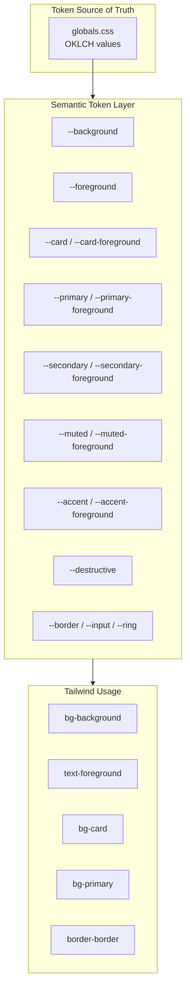
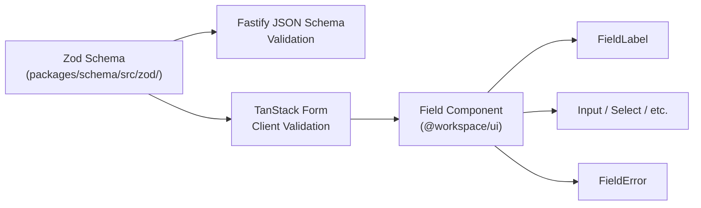

# Design Scheme & Token Specification

## 1. Brand Identity & Aesthetic

The Mrktplace is engineered for high-end boutique apparel stores and modern retail chains. The interface reflects the precision and tactile quality of contemporary fashion houses: quiet, elegant, and uncompromisingly functional.

### Brand Personality
- **Precise**: Every alignment, decimal figure, and stock quantity is mathematically sharp.
- **Refined**: Restrained typography, subtle borders, and balanced whitespace over noisy decoration.
- **Uncluttered**: High-density utility without sensory overload. Every visual element has a functional purpose.
- **Never looks like**: A generic pastel SaaS template with cartoonish illustrations, oversized rounded buttons, or playful gradients.

### Three Signature Design Decisions
1. **Typography & Tabular Numerics**: Inter font utilized across all interfaces, enforcing `tabular-nums` for all price values, inventory counts, and invoice figures to ensure vertical decimal alignment across multi-line tables.
2. **Obsidian & Champagne Palette**: A foundation of deep obsidian (`oklch(0.145 0 0)`) paired with warm metallic accents (champagne gold / refined neutral zinc) rather than common hyper-saturated corporate blues.
3. **Dual-Density Viewports**: The POS terminal operates in an ultra-dense, full-screen tactical grid (zero unwanted scroll, large tap targets for touchscreens), while the merchant admin operates in an expansive, structured workspace with clear visual hierarchy.

---

## 2. Color System & Design Tokens

Tokens are defined using modern **OKLCH** color values in [`packages/ui/src/styles/globals.css`](file:///d:/Personal/marketplace/packages/ui/src/styles/globals.css). Hardcoded hex colors are prohibited in component code.

### 2.1 Token Architecture



### 2.2 Dark Mode (Default Mode)
Dark mode is the primary operational aesthetic for POS counters and merchant oversight.

| Token Name | OKLCH Value | Visual Role |
| --- | --- | --- |
| `--background` | `oklch(0.145 0 0)` | Deep Obsidian canvas background |
| `--foreground` | `oklch(0.985 0 0)` | High-contrast crisp white typography |
| `--card` | `oklch(0.205 0 0)` | Elevated surfaces and card containers |
| `--card-foreground` | `oklch(0.985 0 0)` | Card body text and primary labels |
| `--popover` | `oklch(0.205 0 0)` | Dropdown menus, tooltips, floating sheets |
| `--popover-foreground`| `oklch(0.985 0 0)` | Floating sheet typography |
| `--primary` | `oklch(0.922 0 0)` | Primary actionable elements and buttons |
| `--primary-foreground`| `oklch(0.205 0 0)` | Inverted text on primary buttons |
| `--secondary` | `oklch(0.269 0 0)` | Secondary buttons and auxiliary cards |
| `--secondary-foreground`| `oklch(0.985 0 0)`| Text on secondary surfaces |
| `--muted` | `oklch(0.269 0 0)` | Subtle table row highlights and disabled states |
| `--muted-foreground` | `oklch(0.708 0 0)` | Subtitles, metadata, and placeholder text |
| `--accent` | `oklch(0.269 0 0)` | Hover states on interactive rows and navigation |
| `--accent-foreground`| `oklch(0.985 0 0)` | Text on hovered elements |
| `--destructive` | `oklch(0.704 0.191 22.216)` | Warnings, stock deductions, delete actions |
| `--border` | `oklch(1 0 0 / 10%)` | Subtle 1px dividers and container boundaries |
| `--input` | `oklch(1 0 0 / 15%)` | Form field outline borders |
| `--ring` | `oklch(0.556 0 0)` | Keyboard focus rings and active outlines |

### 2.3 Light Mode (Clean Luxury)
Available for daytime office viewing and standard invoicing.

| Token Name | OKLCH Value | Visual Role |
| --- | --- | --- |
| `--background` | `oklch(1 0 0)` | Pure crisp paper white |
| `--foreground` | `oklch(0.145 0 0)` | Deep obsidian typography |
| `--card` | `oklch(1 0 0)` | Pure white card surfaces with subtle borders |
| `--card-foreground` | `oklch(0.145 0 0)` | Card typography |
| `--primary` | `oklch(0.205 0 0)` | Obsidian buttons with high contrast |
| `--primary-foreground`| `oklch(0.985 0 0)` | White text on primary buttons |
| `--muted` | `oklch(0.97 0 0)` | Neutral soft gray for subtle backgrounds |
| `--muted-foreground` | `oklch(0.556 0 0)` | Charcoal secondary text |
| `--border` | `oklch(0.922 0 0)` | Crisp 1px outline |

### 2.4 Chart Tokens

| Token | OKLCH | Usage |
|---|---|---|
| `--chart-1` | `oklch(0.87 0 0)` | Primary data series |
| `--chart-2` | `oklch(0.556 0 0)` | Secondary data series |
| `--chart-3` | `oklch(0.439 0 0)` | Tertiary data series |
| `--chart-4` | `oklch(0.371 0 0)` | Quaternary data series |
| `--chart-5` | `oklch(0.269 0 0)` | Quinary data series |

---

## 3. Typography Scale & Hierarchy

All applications use **Inter** loaded via `next/font`. Strict hierarchy must be preserved across every screen:

| Role | Tailwind Classes | Usage Context |
| --- | --- | --- |
| **Page Title** | `text-2xl font-semibold tracking-tight` | Header of pages (e.g., "Inventory Ledger", "POS Billing") |
| **Section Heading** | `text-lg font-medium tracking-normal` | Card headers, table section titles, modal headers |
| **Subsection / Card Title** | `text-base font-medium` | Individual metrics cards, item variant headings |
| **Body (Default)** | `text-sm font-normal leading-relaxed` | General descriptive copy, table cell content |
| **Data / Numbers** | `text-sm font-mono font-medium tabular-nums` | Prices, SKU codes, quantities, invoice numbers |
| **Label / Meta** | `text-sm font-medium text-muted-foreground` | Form field labels, status descriptions, breadcrumbs |
| **Micro / Tag** | `text-xs font-medium text-muted-foreground` | Badges, tooltips, keyboard shortcuts (`kbd`), table footers |

---

## 4. Spacing, Grid & Radius

### 4.1 Base Spacing Scale
The layout adheres to an **8px base grid** with 4px half-steps for compact control elements:

| Spacing Context | Tailwind Classes | Base Value |
|---|---|---|
| Page gutters | `px-4 md:px-6 lg:px-8` | 16px / 24px / 32px responsive |
| Section gap | `gap-6` | 24px between major blocks |
| Card internal gap | `gap-4` | 16px inside cards and form groups |
| Inline element gap | `gap-2` | 8px between badges, icon buttons |
| Card padding | `p-4 md:p-6` | 16px / 24px responsive |

### 4.2 Corner Radii

| Token | Computed Value | Usage |
|---|---|---|
| `--radius-sm` | `0.525rem` | Badges, inline tags, small buttons, tooltips |
| `--radius-md` | `0.7rem` | Standard inputs, selects, dropdown menus |
| `--radius-lg` | `0.875rem` | Cards, dialog modals, terminal panels |
| `--radius-xl` | `1.225rem` | Outer container shells |

---

## 5. Component Standards & UI Rules

### 5.1 Component Lifecycle States

Every component, table, and screen must account for all lifecycle states:

```mermaid
stateDiagram-v2
    [*] --> Default
    Default --> Hover: Mouse enters
    Hover --> Default: Mouse leaves
    Default --> FocusVisible: Keyboard focus
    FocusVisible --> Default: Blur
    Default --> Active: Click/tap
    Active --> Default: Release
    Default --> Loading: Data fetching
    Loading --> Default: Data loaded
    Loading --> Error: Request failed
    Default --> Empty: No data
    Default --> Disabled: Condition unmet
```

| State | Implementation Rule |
|---|---|
| **Default** | Pristine resting presentation |
| **Hover** | `transition-colors duration-150` smooth color shift |
| **Focus Visible** | `focus-visible:ring-2 focus-visible:ring-ring focus-visible:ring-offset-2` |
| **Active / Pressed** | Subdued scale (`active:scale-[0.98]`) or background shift |
| **Loading** | `Skeleton` for layout preservation, `Spinner` for inline actions. Never blank screen. |
| **Empty State** | Centered: outline icon + title + description + primary CTA button |
| **Error State** | `Sonner` toasts for notifications; inline `FieldError` for form inputs |
| **Disabled** | `opacity-50 cursor-not-allowed pointer-events-none` |

### 5.2 shadcn/ui "radix-maia" Style Variant
All UI primitives originate from `packages/ui/src/components` (shadcn/ui based on Radix UI).
- No foreign UI component libraries are permitted.
- Custom styled components must wrap existing shadcn primitives.

### 5.3 Icon Conventions (@hugeicons/react)
- **Hugeicons** is the designated icon library for the platform.
- Standard sizing:
  - Inline navigation / buttons: `size={18}` or `className="size-4.5"`
  - Card accents / stat cards: `size={20}` or `className="size-5"`
  - Large empty state visuals: `size={40}` or `className="size-10"`
- Icons must always be accompanied by descriptive text or carry an `aria-label` attribute on icon-only buttons.

### 5.4 Form Architecture



Every form must use:
- **TanStack Form** for form state management
- **Zod** for validation (matching backend schemas exactly)
- `Field`, `FieldLabel`, `FieldError` from `@workspace/ui/components/field`

---

## 6. Accessibility (WCAG 2.2 AA)

| Requirement | Standard | Implementation |
|---|---|---|
| **Text Contrast** | 4.5:1 minimum | Verified against OKLCH token values |
| **Large Text Contrast** | 3:1 minimum | Headers and UI edges |
| **Focus Indicators** | Visible ring | `focus-visible:ring-2` on all interactive elements |
| **Target Size** | 44x44px minimum | POS terminal touch targets |
| **Keyboard Navigation** | Full tab order | POS hotkeys: search, cart, cash, barcode |
| **Reduced Motion** | `prefers-reduced-motion` | Disable transitions and animations |
| **Text Scaling** | Up to 200% | Fluid sizing between breakpoints |
| **Destructive Actions** | Confirmation required | `AlertDialog` with consequence text. No `window.confirm()` |
| **Icon-only Buttons** | `aria-label` required | Every icon button has accessible name |

---

## 7. Responsive Breakpoints

| Breakpoint | Width | Target Device | Layout Behavior |
|---|---|---|---|
| Mobile | 320px+ | Smartphones | Single column, collapsible sidebar |
| Tablet | 768px+ | iPads, POS terminals | Two-column, sidebar visible |
| Desktop | 1280px+ | Laptops, monitors | Full multi-column layout |

The POS terminal (`/pos`) uses a fixed full-screen viewport optimized for 10-inch tablets and above, with no scrolling required during checkout operations.
