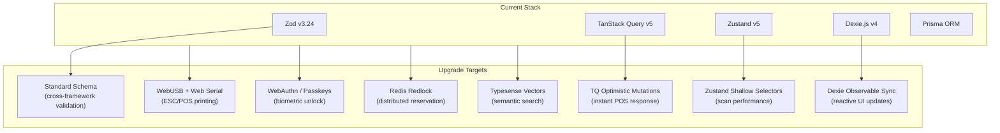
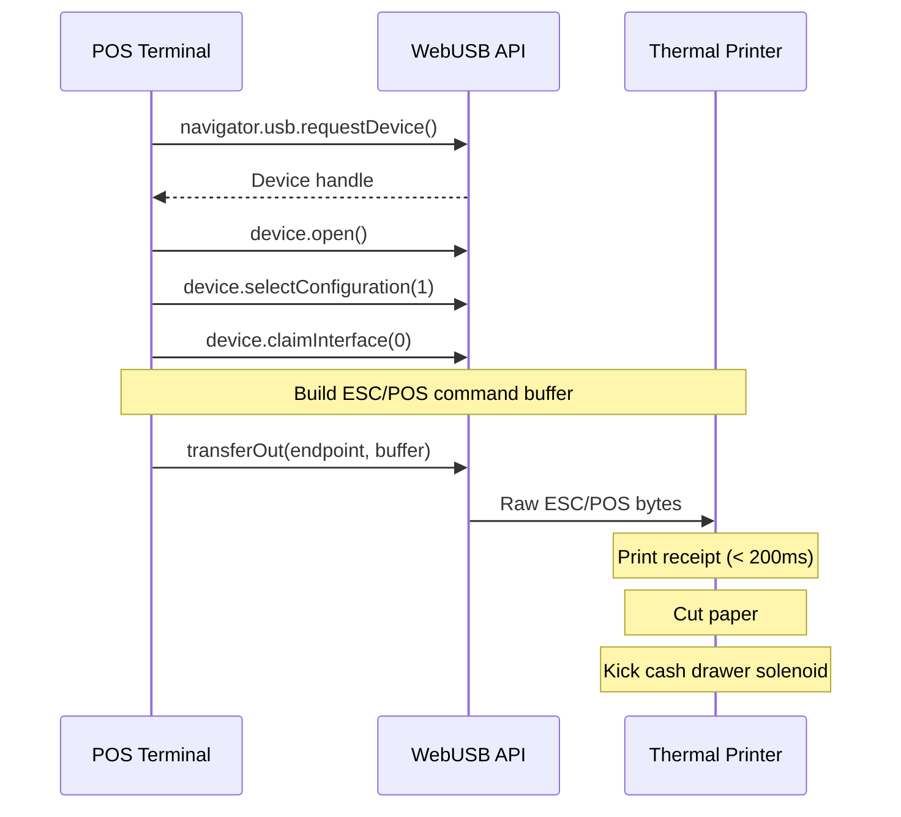
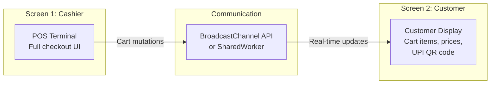
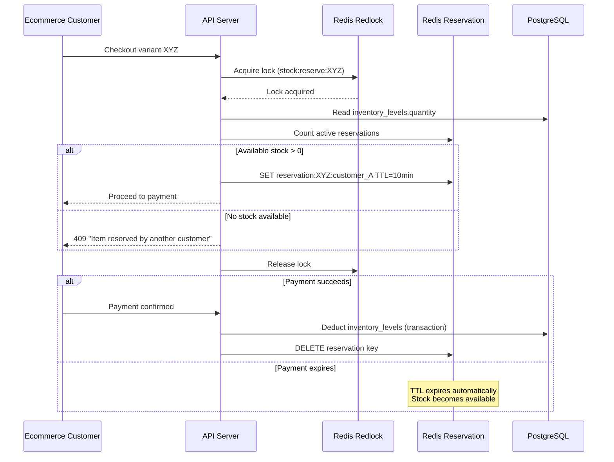
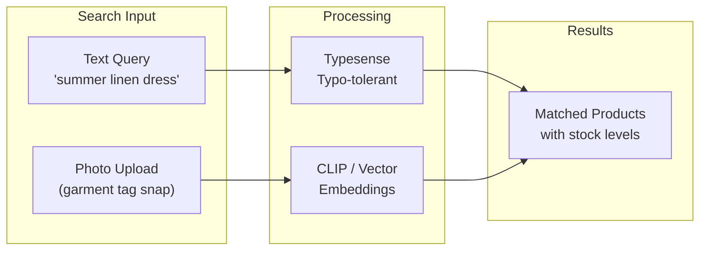
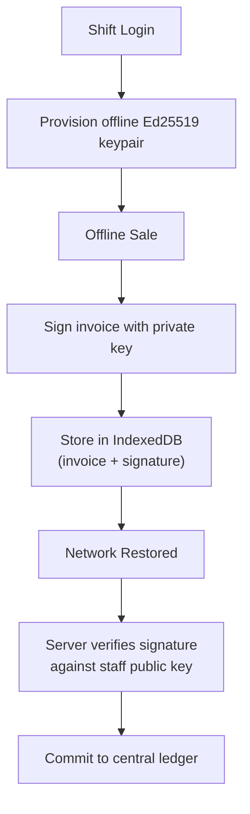

# System Enhancements, Modernized Libraries & Technical Upgrades

This document specifies strategic improvements, modernized libraries, architectural terms, and forward-looking retail features designed to elevate The Mrktplace.

---

## 1. Modernized Library Ecosystem

| Modern Library / API | Replaces | Value |
|---|---|---|
| **Standard Schema + TypeBox / Zod v3.24** | Manual type guards | Unifies validation across Fastify and TanStack Form with near-zero serialization overhead |
| **TanStack Query v5 (Optimistic Mutations)** | Standard Axios fetch in useEffect | Instant optimistic updates with automatic rollback on network failure, critical for POS response time |
| **Zustand v5 with Shallow Selectors** | Monolithic Context API | Granular component re-renders during high-frequency barcode scanning |
| **WebUSB & Web Serial API (ESC/POS)** | Browser `window.print()` dialog | Direct binary communication to thermal printers with zero UI dialog lag |
| **Web Multi-Screen Window Placement API** | Static single-screen layout | Synchronized customer-facing display on secondary counter monitor |
| **WebAuthn / Passkeys** | Text passwords or PINs | Biometric fingerprint / Face ID terminal unlock on modern POS tablets |
| **Redis Redlock Distributed Reservation** | SQL `SELECT FOR UPDATE` | Non-blocking 2-phase inventory reservation during flash sales |
| **Typesense Semantic & Vector Search** | SQL `LIKE '%query%'` | Sub-30ms typo-tolerant search with vector embeddings for visual clothing queries |
| **Dexie.js v4 with Observable Sync** | LocalStorage with JSON | High-capacity indexed local database (50,000+ SKUs) with reactive UI updates |

---

## 2. Hardware Bridge Specifications

### 2.1 Direct ESC/POS Thermal Printing

**ESC/POS Command Reference**:
| Hex Command | Action |
|---|---|
| `0x1B 0x40` | Initialize printer |
| `0x1B 0x61 0x01` | Center alignment |
| `0x1B 0x45 0x01` | Bold on |
| `0x1D 0x56 0x41` | Cut paper |
| `0x1B 0x70 0x00 0x19 0xFA` | Kick cash drawer solenoid |

**Benefits**:
- Receipts print in under 200 milliseconds without browser print dialog.
- Cash drawer triggers automatically on cash payment completion.
- Custom vector logos and UPI QR codes print directly onto receipts.

### 2.2 Dual-Screen Customer Display

When multiple monitors are connected:
1. `window.getScreenDetails()` detects available screens.
2. A customer-facing window opens on the extended display.
3. Cart mutations stream via BroadcastChannel in real time.
4. Customer sees line items, discounts, and a dynamic UPI QR code.

---

## 3. Advanced Retail Functionalities

### 3.1 Distributed Inventory Reservation

For omnichannel flash sales where simultaneous online and in-store purchases compete for the same stock:

### 3.2 AI-Powered Visual Product Search

- **Visual duplicate search**: Staff snap a photo of a garment to instantly pull up SKU and warehouse stock.
- **Natural language fashion search**: Customers search conceptual queries like "boho wedding guest dress in emerald green."

### 3.3 Dynamic Barcode & Clothing Tag Generation

Standard symbologies generated server-side:

| Format | Dimensions | Content |
|---|---|---|
| **EAN-13 garment tag** | 50mm x 25mm | Product name, size, color, barcode, MRP, GST class |
| **Code-128 compact sticker** | 38mm x 25mm | SKU barcode, price, size |
| **QR code tag** | 25mm x 25mm | Deep link to product detail page |

### 3.4 Cryptographically Signed Offline Invoices

Prevents tampering with offline sales records in IndexedDB. The server rejects any invoice whose signature does not match the staff member's registered public key.

---

## 4. Architectural Terms Glossary

| Term | Full Form | Definition |
|---|---|---|
| **BOPIS** | Buy Online, Pick Up In Store | Customer orders online and collects from the physical store |
| **BORIS** | Buy Online, Return In Store | Customer returns an online order at the physical store |
| **HSN** | Harmonized System of Nomenclature | Mandatory 6 or 8-digit commodity codes for Indian GST invoicing |
| **Split Tender** | - | A sale funded across multiple payment channels (e.g., ₹1,500 Cash + ₹2,000 UPI) |
| **Held/Parked Cart** | - | A transient checkout order stored in Redis or IndexedDB while the customer continues browsing |
| **Stock Movement Ledger** | - | The append-only audit trail (`inventory_movements`) guaranteeing stock count traceability |
| **Ghost Shift** | - | An unclosed staff shift flagged when a terminal goes inactive without cash reconciliation |
| **AOV** | Average Order Value | Total revenue divided by total transactions |
| **RFM** | Recency, Frequency, Monetary | Customer segmentation model based on purchasing behavior |
| **AWB** | Airway Bill | Shipping tracking number issued by courier provider |
| **MRR** | Monthly Recurring Revenue | Total recurring subscription revenue per month |
| **LTV** | Lifetime Value | Predicted total revenue from a customer over their relationship |
| **SKU** | Stock Keeping Unit | Unique identifier for each distinct product variant |
| **UPI** | Unified Payments Interface | India's real-time inter-bank payment system |
| **GSTIN** | GST Identification Number | 15-digit alphanumeric code assigned to registered GST taxpayers |
| **PWA** | Progressive Web App | Web application installable on devices with offline capability |
| **ESC/POS** | Epson Standard Code for POS | Industry-standard binary command protocol for receipt printers |
| **HID** | Human Interface Device | USB device class for keyboards, barcode scanners, and similar input peripherals |
