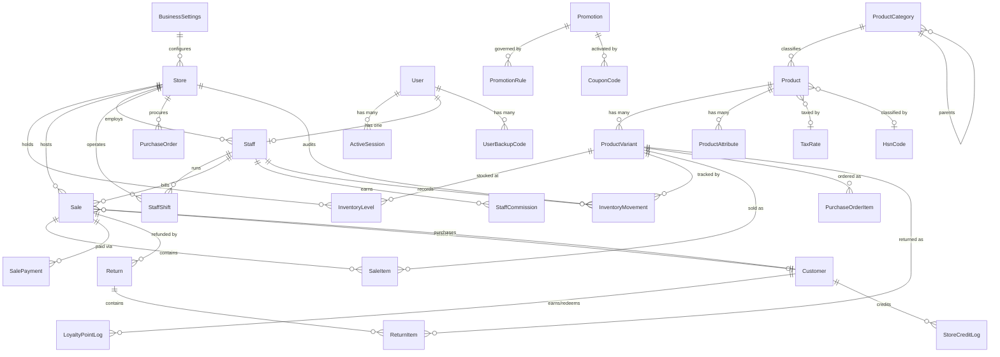
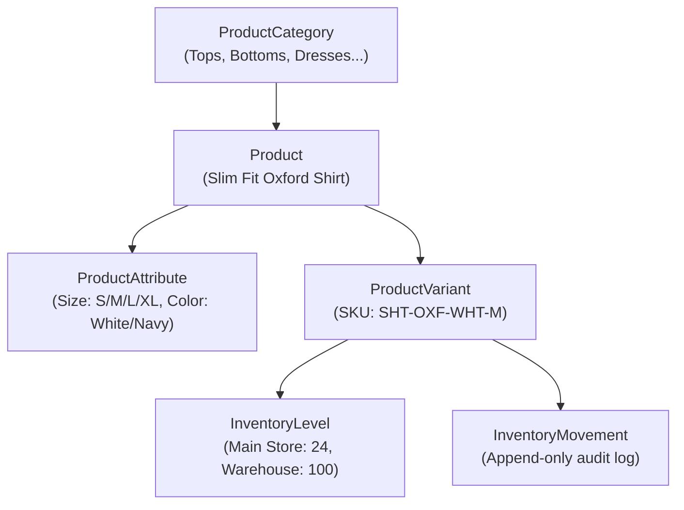

# Database & Data Schema Specification (Standalone Omnichannel Retail)

The Mrktplace platform enforces clean single-brand multi-store relational data, immutable inventory audit trails, and transactional financial integrity across all retail operations.

Source of truth: [`packages/schema/src/prisma/schema.prisma`](file:///d:/Personal/marketplace/packages/schema/src/prisma/schema.prisma)

---

## 1. Standalone Entity Relationship Overview



---

## 2. Business Profile & Multi-Store Hierarchy

### 2.1 Business Settings (`business_settings`)
Represents the brand/company configuration:
- `id`: CUID Primary Key.
- `businessName`: Brand trade name (e.g. "The Mrktplace Apparel").
- `legalName`: Registered company entity.
- `gstRegistered`: Boolean flag indicating Indian GST registration.
- `gstin`: 15-character GST Identification Number.
- `currency`: Default ISO currency (default: `INR`).
- `addressLine1/2`, `city`, `state`, `pincode`, `country`: Company headquarters address.
- `logoUrl`: Brand logo used on invoices, receipts, and storefront.
- `websiteEnabled`: Boolean flag controlling whether the customer web storefront accepts online transactions.
- `announcementBanner`: Top promotional text string displayed on the customer website.
- `featuredCollectionName`: Name of the curated collection displayed on the storefront landing page.

### 2.2 Store Branches (`stores`)
A retail brand can operate multiple physical and digital locations:
- `id`: CUID Primary Key.
- `name`: Store name (e.g. "Main Flagship Store", "Mall of India Branch", "Central Warehouse").
- `code`: Unique alphanumeric identifier (e.g. `MAIN-01`, `WH-01`).
- `storeType`: Branch classification (`Retail Store`, `Warehouse`, `Pop-up`, `Online Fulfillment`).
- `receiptHeader` & `receiptFooter`: Custom header greeting and return policy text for thermal receipts.
- `defaultTaxRate`: Base tax rate applied when item tax is not explicitly set.
- `roundOffBills`: Boolean flag to round total invoices to nearest ₹1.

---

## 3. Users, Staff & Cashier Shifts

### 3.1 User Model (`users`)
- `id`: CUID Primary Key.
- `email`: Globally unique email address across the organization.
- `passwordHash`: Bcrypt hash (work factor: 12).
- `role`: Enum (`OWNER`, `MANAGER`, `CASHIER`).
- `mfaEnabled`, `mfaSecret`: TOTP multi-factor authentication.

### 3.2 Staff & Cashier Shifts (`staff`, `staff_shifts`, `staff_commissions`)
- `staff`: Binds a `User` to a physical `Store`. Stores `employeeCode`, `position`, `commissionRate`, and `pinHash` (bcrypt hash of 4-6 digit POS quick PIN).
- `staff_shifts`: Logs cashier shift accounting. Tracks `openingCash`, `expectedCash`, `closingCash`, and `discrepancy` for end-of-day register balancing.
- `staff_commissions`: Immutable log linking a `Sale` to a `Staff` member with the exact `commissionAmount` calculated.

---

## 4. Product Catalog & Apparel Variant Matrix



### 4.1 Products & Dimensional Variants
- `products`: Base garment item. Holds `basePrice`, `costPrice`, `lowStockAlert`, `taxRateId`, `hsnCodeId`.
- `product_attributes`: Dimensional options (e.g., Attribute: `Size`, Values: `["S", "M", "L", "XL"]`).
- `product_variants`: The purchasable SKU. Every combination has a unique `sku` and optional `barcode`. Attributes stored in JSON: `{"Size": "M", "Color": "White"}`.

### 4.2 Inventory Movements (`inventory_movements`)
Append-only audit trail for every single stock change:
- `quantity`: Positive for stock additions, negative for stock deductions.
- `reason`: Enum (`SALE`, `RETURN`, `PURCHASE_RECEIPT`, `MANUAL_ADJUSTMENT`, `TRANSFER`, `DAMAGE`).
- `staffId`: Audited staff member responsible for the change.
- `referenceId`: Associated Sale ID, PO ID, or Return ID.

---

## 5. Sales, Split Payments, Omnichannel & Customers

### 5.1 Sales (`sales`, `sale_items`, `sale_payments`)
- `sales`:
  - `invoiceNumber`: Unique alphanumeric invoice code (e.g., `INV-2026-00412`).
  - `channel`: Enum (`POS`, `WEBSITE`). Identifies in-store POS register bills versus online customer orders.
  - `subtotal`: Sum of all items before discounts and taxes.
  - `discountAmount`: Total order-level discount.
  - `taxAmount`: Total tax calculated.
  - `grandTotal`: Final payable amount (`subtotal - discountAmount + taxAmount`).
  - `status`: `COMPLETED`, `REFUNDED`, `VOIDED`.
  - `fulfillmentStatus`: Enum (`PENDING`, `PACKED`, `SHIPPED`, `DELIVERED`, `FULFILLED`). Real-time order fulfillment status tracked inside the POS terminal.
  - `shippingAddress`: Optional JSON object containing delivery address details or BOPIS store pickup instructions.
- `sale_payments`: Supports split tender on a single order.
  - `method`: Enum (`CASH`, `CARD`, `UPI`, `STORE_CREDIT`, `LOYALTY_POINTS`).
  - `amount`: Amount paid through this method.
  - `referenceId`: UPI UTR number or Card approval code.

### 5.2 Customers & Web Accounts (`customers`, `loyalty_point_logs`, `store_credit_logs`)
- `customers`:
  - `id`: CUID Primary Key.
  - `name`: Customer full name.
  - `phone`: Mobile phone number (used for POS billing lookup and SMS alerts).
  - `email`: Optional email address, required for customer web login.
  - `passwordHash`: Bcrypt hash for website authentication (strictly customer-facing).
  - `loyaltyPoints`: Accrued points earned across POS and online purchases.
  - `storeCredit`: Available monetary balance usable as tender method at checkout.
- `loyalty_point_logs`: Immutable ledger of points earned and redeemed.
- `store_credit_logs`: Immutable ledger of store credit additions and deductions.

---

## 6. Offline POS Schema (Flutter SQLite / Drift)

The Flutter POS app (`apps/pos`) maintains a local SQLite database for offline counter billing:

```sql
-- Local Offline Tables
CREATE TABLE offline_products (
  id TEXT PRIMARY KEY,
  name TEXT NOT NULL,
  category_name TEXT,
  base_price REAL NOT NULL
);

CREATE TABLE offline_variants (
  id TEXT PRIMARY KEY,
  product_id TEXT NOT NULL,
  sku TEXT UNIQUE NOT NULL,
  barcode TEXT UNIQUE,
  price REAL NOT NULL,
  stock_quantity INTEGER NOT NULL
);

CREATE TABLE pending_sales (
  id TEXT PRIMARY KEY,
  invoice_number TEXT UNIQUE NOT NULL,
  sale_payload TEXT NOT NULL, -- Full JSON invoice
  created_at TEXT NOT NULL,
  synced INTEGER DEFAULT 0    -- 0: pending, 1: synced
);

CREATE TABLE active_shift (
  id TEXT PRIMARY KEY,
  staff_id TEXT NOT NULL,
  store_id TEXT NOT NULL,
  opening_cash REAL NOT NULL,
  opened_at TEXT NOT NULL
);
```
