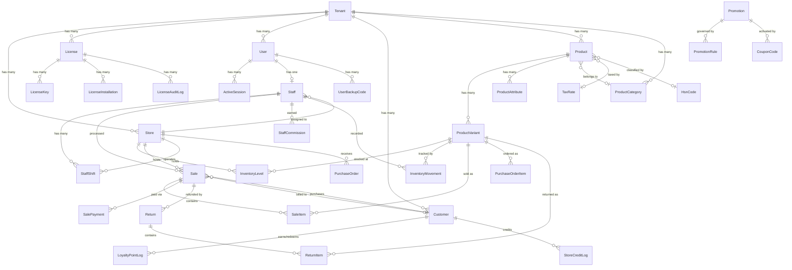
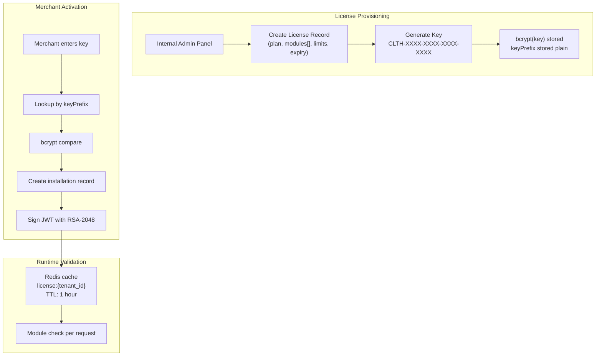
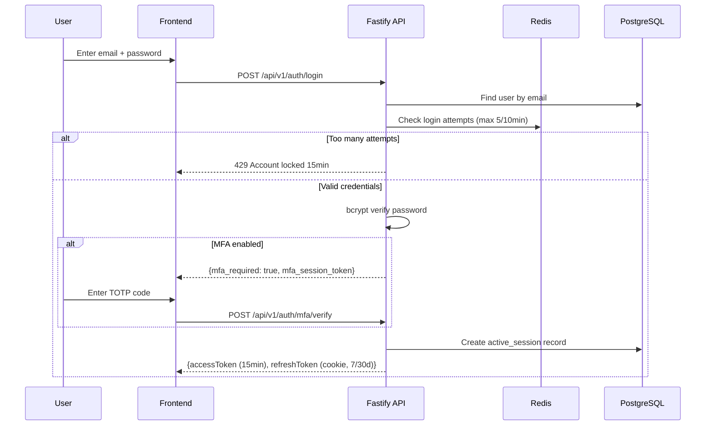
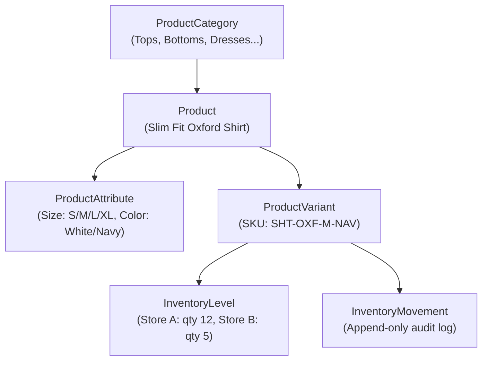
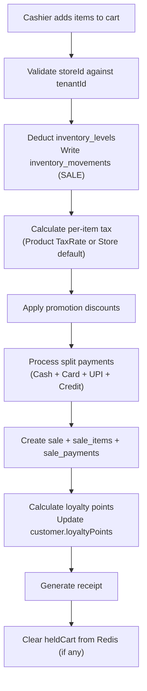
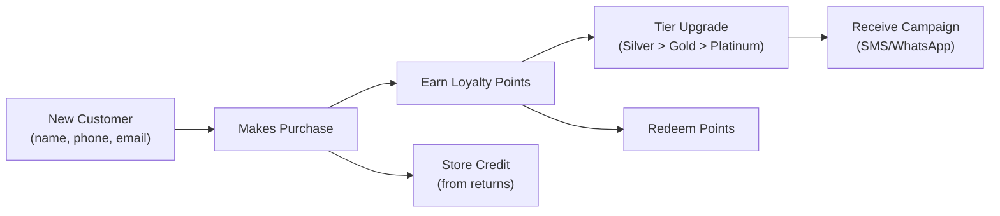

# Database & Data Schema Specification

The Mrktplace platform enforces strict multi-tenant isolation, immutable audit trails, and transactional financial integrity across all retail operations.

Source of truth: [`packages/schema/src/prisma/schema.prisma`](file:///d:/Personal/marketplace/packages/schema/src/prisma/schema.prisma)

---

## 1. Entity Relationship Overview



---

## 2. Multi-Tenancy & Licensing

### 2.1 Tenant Model (`tenants`)

| Field | Type | Description |
|---|---|---|
| `id` | CUID | Primary key |
| `businessName` | String | Official trade name |
| `businessType` | String? | Single Store, Multi-Store Chain, Omnichannel |
| `gstRegistered` | Boolean | Indian GST registration status |
| `gstin` | String? | 15-character GST Identification Number |
| `currency` | String | Default: `INR` |
| `financialYearStart` | String | Default: `April` |
| `onboardingStep` | Int | Current setup step (0 through 6) |
| `onboardingCompleted` | Boolean | Wizard completion flag |
| `addressLine1/2`, `city`, `state`, `pincode`, `country` | String? | Registered business address |
| `logoUrl` | String? | Business logo for invoices and receipts |

### 2.2 License System



**Module codes available**:

| Code | Description | Plan Inclusion |
|---|---|---|
| `POS_CORE` | Terminal billing, shifts, cash reconciliation | Always on |
| `MULTISTORE` | Multi-location inventory, inter-store transfers | Professional+ |
| `PROMO_PRO` | Advanced discount matrices, flash deals | Professional+ |
| `CRM_PRO` | Customer segmentation, automated campaigns | Professional+ |
| `STAFF_PRO` | Commission tracking, hourly targets | Professional+ |
| `ECOM_STORE` | Customer-facing Next.js storefront | Add-on |
| `ECOM_ORDER` | Online order packing, dispatch, click-and-collect | Add-on |
| `ECOM_SHIPPING` | Courier integration (Delhivery, Shiprocket) | Add-on |
| `ECOM_MARKETING` | Abandoned cart, email campaigns | Add-on |
| `ANALYTICS_PRO` | Predictive turnover, cohort retention, margins | Add-on |
| `MARKETPLACE` | Amazon, Flipkart, Myntra two-way sync | Add-on |
| `WHATSAPP_COMMERCE` | WhatsApp catalog and conversational orders | Add-on |
| `API_ACCESS` | Public REST API for third-party integrations | Add-on |
| `FRANCHISE` | Corporate chain controls | Enterprise only |

---

## 3. Authentication & Staff

### 3.1 User Model (`users`)

| Field | Type | Description |
|---|---|---|
| `id` | CUID | Primary key |
| `tenantId` | String (FK) | Scoped to tenant |
| `email` | String | Unique within tenant |
| `phone` | String? | Contact number |
| `name` | String | Display name |
| `passwordHash` | String | bcrypt (work factor 12) |
| `role` | Enum | `OWNER`, `MANAGER`, `CASHIER` |
| `mfaEnabled` | Boolean | TOTP 2FA active |
| `mfaSecret` | String? | Encrypted TOTP secret |
| `emailVerified` | Boolean | Email verification status |
| `phoneVerified` | Boolean | Phone verification status |

**Unique constraint**: `@@unique([tenantId, email])`

### 3.2 Auth Flow



### 3.3 Staff & Shifts

| Model | Key Fields | Purpose |
|---|---|---|
| `staff` | `userId`, `storeId`, `pinHash`, `commissionRate`, `employeeCode` | Binds User to Store with POS PIN |
| `staff_shifts` | `staffId`, `storeId`, `openingCash`, `closingCash`, `discrepancy` | Cash reconciliation per shift |
| `staff_commissions` | `staffId`, `saleId`, `commissionAmount` | Immutable commission record per sale |

---

## 4. Product Catalog & Inventory

### 4.1 Product Hierarchy



### 4.2 Inventory Movement Reasons

| Reason Enum | Direction | Trigger |
|---|---|---|
| `SALE` | Negative | Checkout completes |
| `RETURN` | Positive | Return processed |
| `PURCHASE_RECEIPT` | Positive | PO items received |
| `MANUAL_ADJUSTMENT` | Either | Staff manual count correction |
| `TRANSFER` | Either | Inter-store stock transfer |
| `DAMAGE` | Negative | Damaged goods write-off |

Every mutation occurs inside a Prisma `$transaction` that atomically updates `inventory_levels` and appends an `inventory_movements` record.

---

## 5. Sales, Payments & Returns

### 5.1 Sale Transaction Flow



### 5.2 Financial Field Types

All financial values use `Decimal(12, 2)`. Never floating point for money.

| Model | Key Financial Fields |
|---|---|
| `sales` | `subtotal`, `discountAmount`, `taxAmount`, `grandTotal` |
| `sale_items` | `unitPrice`, `discountAmount`, `taxRate`, `taxAmount`, `total` |
| `sale_payments` | `amount` per payment method |
| `returns` | `refundAmount` |
| `return_items` | `refundAmount` per item |

### 5.3 Payment Methods

| Enum Value | Description |
|---|---|
| `CASH` | Physical cash tendered |
| `CARD` | Debit/credit card (manual entry or terminal) |
| `UPI` | Unified Payments Interface (QR scan) |
| `STORE_CREDIT` | Customer store credit balance |
| `LOYALTY_POINTS` | Redeemed loyalty points as discount |

---

## 6. CRM, Loyalty & Promotions

### 6.1 Customer Lifecycle



### 6.2 Promotion Rules

| Field | Values | Description |
|---|---|---|
| `discountType` | `PERCENTAGE`, `FLAT_AMOUNT` | Type of discount applied |
| `discountValue` | Decimal | Numerical discount value |
| `minOrderValue` | Decimal? | Minimum cart subtotal threshold |
| `appliesTo` | `ALL`, `CATEGORY`, `PRODUCT` | Scope of the discount |

---

## 7. Offline Terminal Schema (Dexie.js / IndexedDB)

The POS terminal maintains an offline-first data replica:

```typescript
// Dexie Database: 'MrktplaceOfflinePOS'
db.version(1).stores({
  products:      'id, sku, barcode, name, categoryId, price',
  customers:     'id, phone, name, loyaltyPoints, storeCredit',
  pendingSales:  '++localId, invoiceNumber, createdAt, synced',
  activeShift:   'id, staffId, storeId, openedAt',
  cachedLicense: 'tenantId, planCode, expiresAt'
});
```

| Table | Index Keys | Sync Direction |
|---|---|---|
| `products` | `id`, `sku`, `barcode` | Server to Client (pull every 15min) |
| `customers` | `id`, `phone` | Server to Client (pull every 15min) |
| `pendingSales` | `localId`, `synced` | Client to Server (push on reconnect) |
| `activeShift` | `id` | Bidirectional |
| `cachedLicense` | `tenantId` | Server to Client (pull every 24h) |

---

## 8. Zod Validation Contracts

All request bodies are strictly validated using Zod schemas in [`packages/schema/src/zod/`](file:///d:/Personal/marketplace/packages/schema/src/zod):

| File | Exported Schemas | Used By |
|---|---|---|
| `auth.ts` | `registerSchema`, `loginSchema`, `verifyEmailSchema`, `pinLoginSchema` | Auth module (API + Dashboard) |
| `tenant.ts` | `tenantProfileSchema`, `storeSetupSchema`, `onboardingWizardSchema` | Onboarding wizard |
| `product.ts` | `createProductSchema`, `createVariantSchema`, `adjustInventorySchema` | Inventory module |
| `sale.ts` | `createSaleSchema`, `heldCartSchema`, `processReturnSchema` | POS terminal + Sales |
| `shift.ts` | `openShiftSchema`, `closeShiftSchema` | Shift management |
| `staff.ts` | `createStaffSchema`, `updateStaffPermissionsSchema` | Staff module |
| `customer.ts` | `createCustomerSchema`, `redeemPointsSchema` | CRM module |

Every frontend TanStack Form must import and use the exact same Zod schema as the corresponding backend route validation. Zero deviation.

---

## 9. Database Indexing Strategy

| Table | Index | Purpose |
|---|---|---|
| `license_keys` | `@@index([keyPrefix])` | Fast license key lookup by prefix |
| `active_sessions` | `@@index([refreshTokenHash])` | Token refresh verification |
| `users` | `@@unique([tenantId, email])` | Tenant-scoped email uniqueness |
| `product_variants` | `@unique` on `sku`, `@unique` on `barcode` | SKU and barcode lookups |
| `inventory_levels` | `@@unique([variantId, storeId])` | One record per variant per store |
| `customers` | `@@unique([tenantId, phone])`, `@@unique([tenantId, email])` | Customer dedup within tenant |
| `coupon_codes` | `@unique` on `code` | Coupon code validation |
| `hsn_codes` | `@@unique([tenantId, code])` | HSN code uniqueness per tenant |
