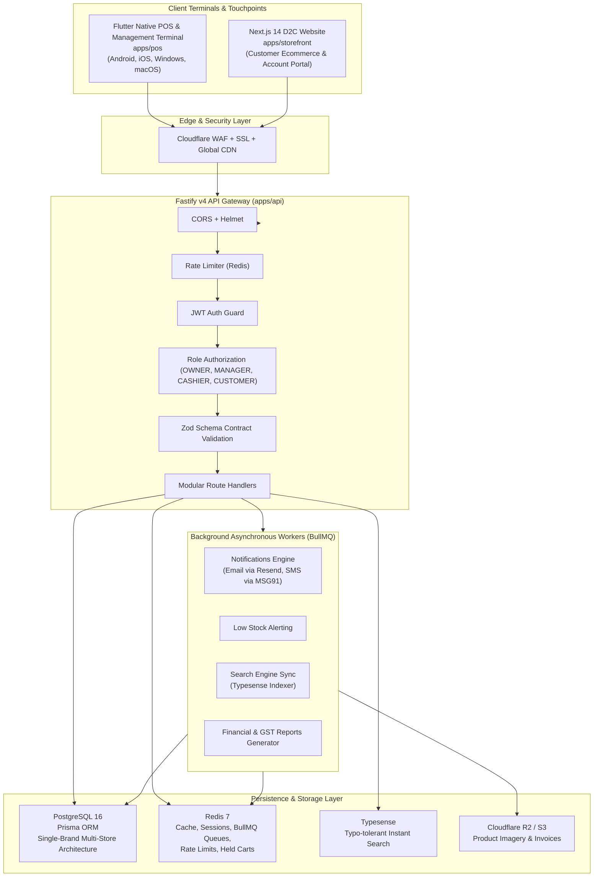
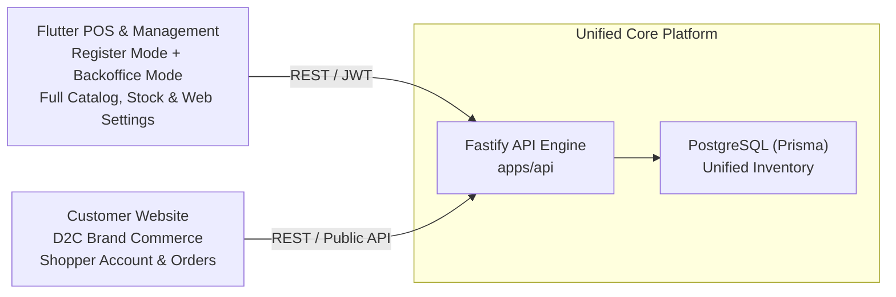
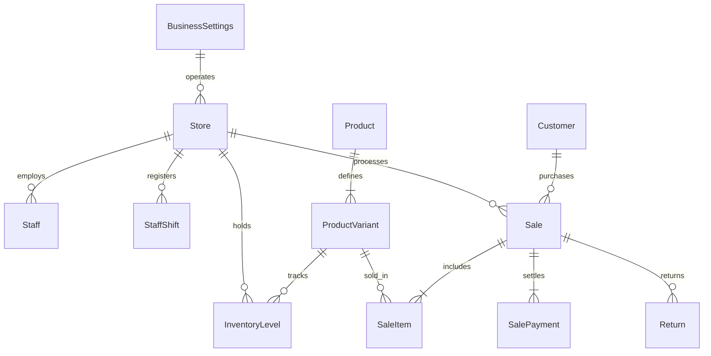
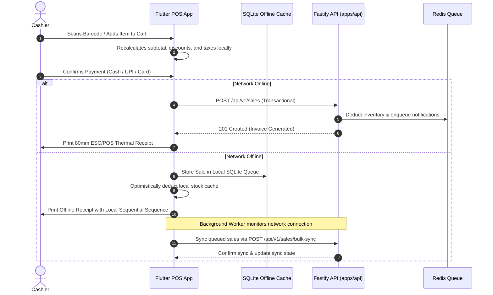

# System Architecture & Technical Topology

themrktplace is structured as a high performance Standalone Omnichannel Retail Suite tailored for modern retail and fashion brands. It unites physical store point-of-sale terminals, a central operations backoffice, and customer-facing ecommerce into a unified real-time inventory engine.

---

## 1. High-Level System Topology

---

## 2. Omnichannel Architecture & Application Matrix

| Application | Technology | Primary Audience | Key Responsibilities |
|---|---|---|---|
| **POS & Management Terminal** (`apps/pos`) | Flutter 3.13+ (Dart 3) | Store Owners, Managers & Cashiers | Register billing mode (tenders, ESC/POS printing, shifts) + Management mode (products, stock, web order fulfillment, reports, staff, website banner). |
| **Customer Storefront** (`apps/storefront`) | Next.js 14, Tailwind CSS, shadcn/ui | Direct-to-Consumer Shoppers | Fast browse, faceted filter, shopping bag, checkout, BOPIS store pickup, customer account login. |
| **Backend API** (`apps/api`) | Fastify v4, TypeScript, BullMQ | Internal & Client Applications | High throughput REST endpoints, staff & customer authentication, inventory locking, transaction safety, audit trail. |

---

## 3. Database Schema & Architecture Shift

The architecture has eliminated all multi-tenant isolation overhead (`tenantId` columns, `Tenant` tables, SaaS license validation) in favor of a direct **Single-Brand Omnichannel Model**:

1. **Brand Configuration**: Stored in `BusinessSettings` table (`id: "default"`), holding company legal identity, GSTIN, and global retail defaults.
2. **Multi-Store Capability**: The brand can operate multiple physical store locations (`Store` table) such as Retail Stores, Outlets, and Warehouses.
3. **Inventory Isolation per Store**: Stock levels (`InventoryLevel`) and stock adjustments (`InventoryMovement`) are tracked strictly per store variant pair (`variantId`, `storeId`).
4. **Unified Product Catalog**: Products and categories are managed brand-wide, allowing instantaneous visibility across both physical POS terminals and web storefronts.

---

## 4. Edge and Offline Resilience Strategy

---

## 5. Security & Cryptographic Standards

- **Password Storage**: Passwords hashed using bcrypt with cost factor 12.
- **PIN Storage**: Cashier staff PINs hashed using bcrypt with cost factor 12.
- **Session Tokens**: Short-lived stateless JWT access tokens (15 minute expiration) paired with cryptographically secure, SHA-256 hashed refresh tokens persisted in Redis/PostgreSQL.
- **MFA Security**: TOTP standards (RFC 6238) with AES-256 encrypted server secrets and 8 emergency single-use backup recovery codes.
- **Strict Role-Based Access Control**:
  - `OWNER`: Full business authority, tax settings, staff compensation, and financial exports.
  - `MANAGER`: Store branch management, inventory adjustments, purchase order receipt, and shift approvals.
  - `CASHIER`: Point of sale checkout, held carts, and register shift drawer balancing.
