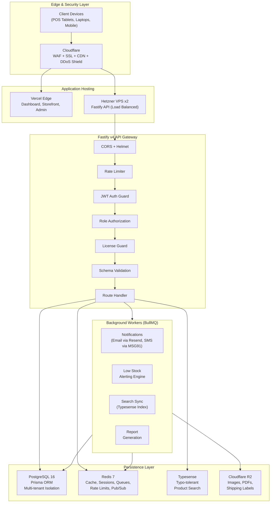
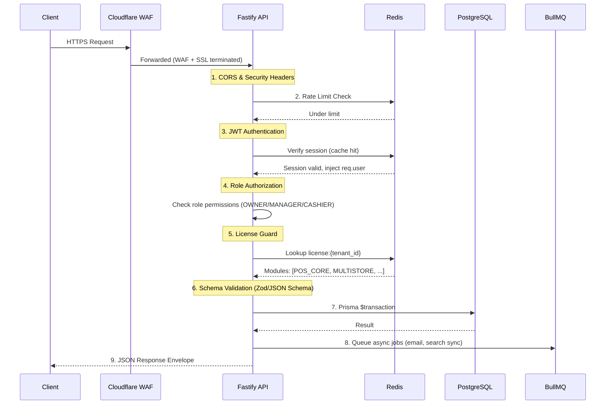
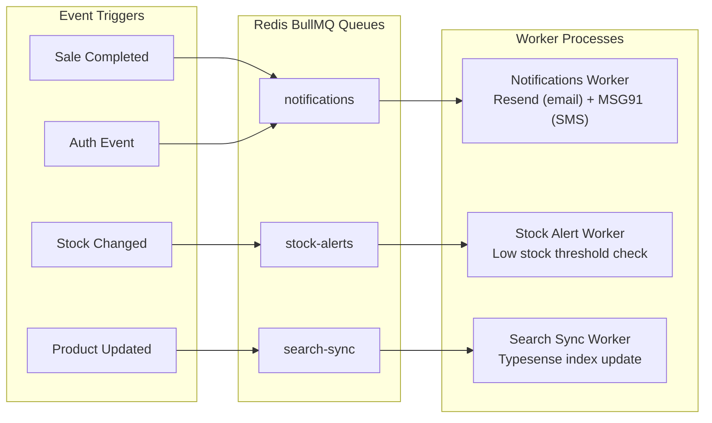
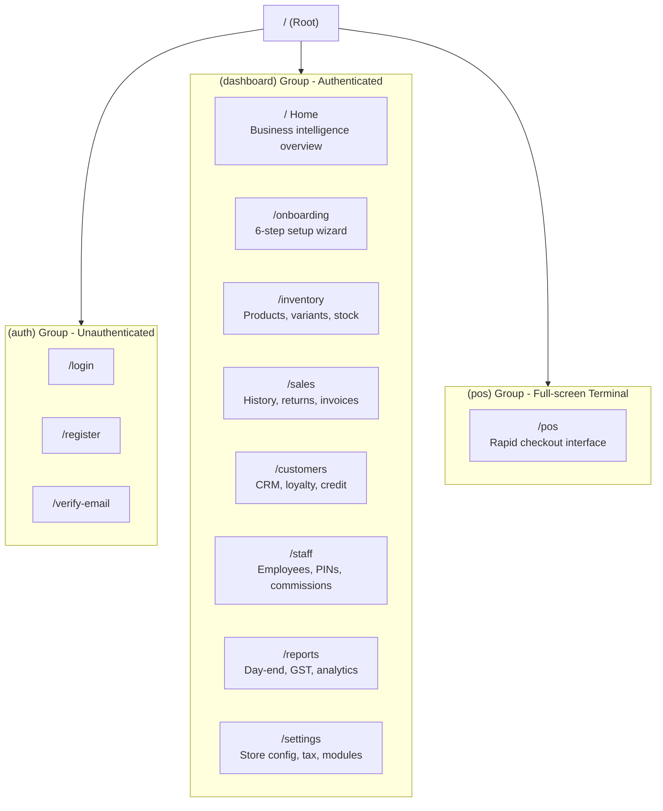
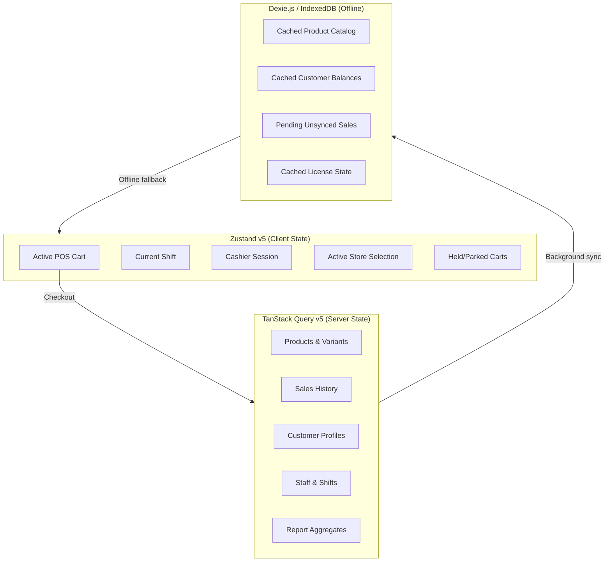
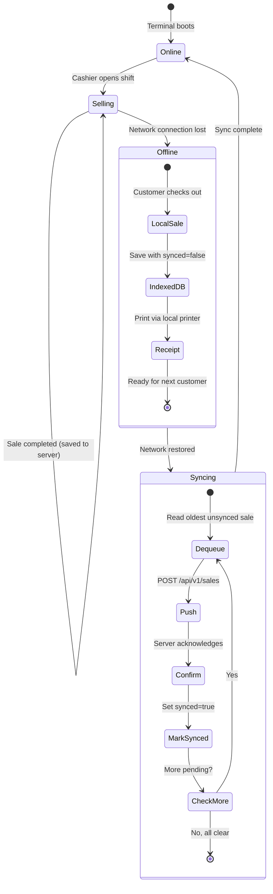
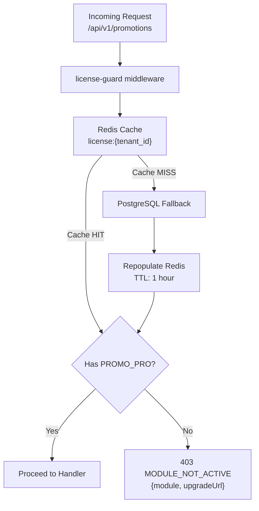
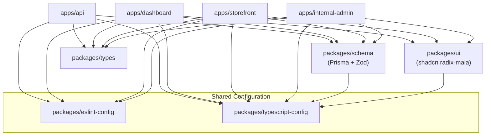
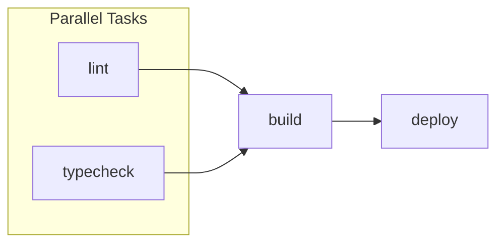

# System Architecture & Technical Topology

The Mrktplace is structured as a distributed, multi-tenant cloud platform with an offline-resilient edge terminal.

---

## 1. High-Level System Topology



---

## 2. API Request Lifecycle

Every HTTP request to the Fastify API undergoes a strict sequential middleware pipeline before reaching the route handler.



### Middleware Stack Details

| Order | Middleware | Source File | Purpose |
|---|---|---|---|
| 1 | CORS + Security | `@fastify/cors`, `@fastify/helmet` | Cross-origin policy, security headers, CSP |
| 2 | Rate Limiter | `@fastify/rate-limit` | Redis-backed request throttling per IP and tenant |
| 3 | Authentication | `middleware/authenticate.ts` | JWT signature verification, session state check, injects `req.user` |
| 4 | Authorization | `middleware/authorize.ts` | Role-based access control (`OWNER`, `MANAGER`, `CASHIER`) |
| 5 | License Guard | `middleware/license-guard.ts` | Module flag check against tenant license, Redis cache with DB fallback |
| 6 | Validation | Fastify JSON Schema + Zod | Request params, query, and body validated before handler |
| 7 | Handler | Route-specific service | Prisma transactional operations |
| 8 | Async Queue | BullMQ | Side effects dispatched to background workers |

---

## 3. Background Workers (BullMQ)

Heavy operations and asynchronous events are decoupled from the HTTP thread:



---

## 4. Frontend Architecture

### 4.1 Dashboard Route Map



### 4.2 State Management Architecture

Frontend state is deliberately separated by lifecycle and source of truth to prevent cross-contamination and enable offline resilience:



| Layer | Library | What it holds | Persistence |
|---|---|---|---|
| Client UI State | Zustand v5 | Active cart, current shift, cashier PIN, held carts, active store | In-memory (lost on refresh) |
| Server State | TanStack Query v5 | Products, sales, customers, staff, reports | Auto-cached with stale-while-revalidate |
| Offline Persistence | Dexie.js (IndexedDB) | Product catalog, customer balances, pending sales, license cache | Persistent across sessions |

---

## 5. Offline-First POS Sync Engine

The POS terminal is engineered to function continuously even during internet outages.



### Sync Rules
1. **Catalog pull**: Every 15 minutes (and on manual trigger), the terminal pulls updated products and customer balances into IndexedDB.
2. **Offline sales**: If network drops, sales are saved to IndexedDB with `synced: false`. Receipts print via local USB/Bluetooth thermal printer.
3. **FIFO sync**: On reconnection, pending sales are pushed in chronological order. Each sale is confirmed before the next is sent.
4. **Conflict resolution**: Server-side timestamp comparison prevents duplicate invoice numbers.

---

## 6. Licensing & Feature-Flag Security

Modules are licensed individually. A store owner cannot access premium features unless their tenant license includes the respective module code.



**Frontend enforcement**: The `useLicense` hook gates UI sections client-side:
```tsx
const { hasModule } = useLicense();

if (!hasModule("PROMO_PRO")) {
  return <UpgradePrompt module="PROMO_PRO" />;
}
```

---

## 7. Monorepo Package Dependency Graph



### Build Pipeline (Turborepo)



Turborepo caches build outputs and only rebuilds packages whose source files (or dependencies) have changed.
