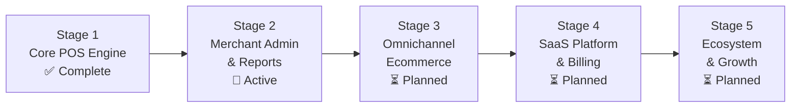
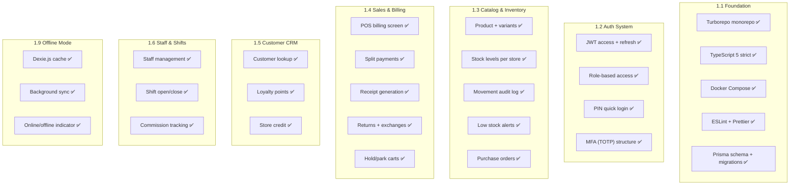
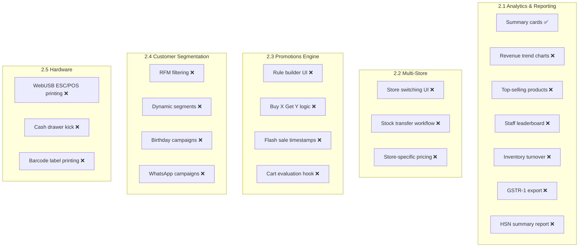
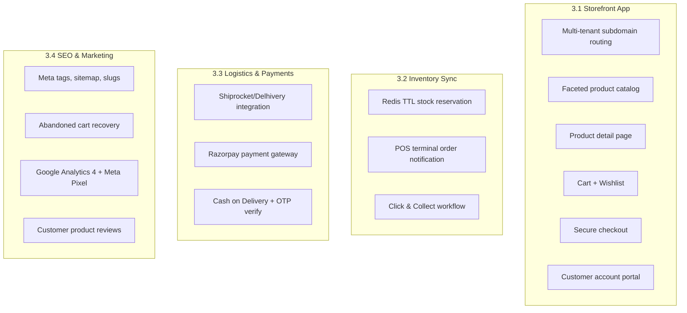
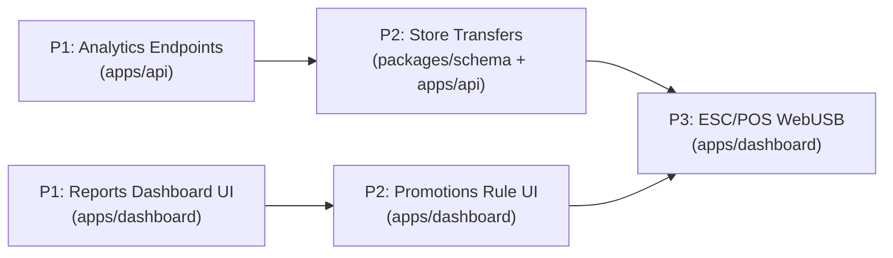

# Master Roadmap & Actionable TODOs

This document maintains the canonical status of all development stages and granular module TODOs.

---

## Stage Progression Overview

| Stage | Name | Revenue Target | Status |
|---|---|---|---|
| **1** | Core POS Application | ₹500-1,500/mo per merchant | **100% Complete** |
| **2** | Merchant Admin & Advanced POS | ₹1,500-4,000/mo per merchant | **Active Development** |
| **3** | Omnichannel Ecommerce | ₹4,000-12,000/mo per merchant | **Planned** |
| **4** | SaaS Control Panel & Billing | Internal operations | **Planned** |
| **5** | Enterprise & Ecosystem | ₹12,000+/mo per merchant | **Planned** |

Each stage generates revenue that funds the next. No stage is built until the previous one is stable and validated with real merchants.

---

## Stage 1: Core POS Application (Complete)

### Completion Summary

### Detailed Checklist
- [x] Turborepo monorepo with apps (api, dashboard, storefront, internal-admin) and packages (schema, ui, types).
- [x] Prisma database schema with PostgreSQL 16.
- [x] Docker Compose for local development (PostgreSQL, Redis, Typesense).
- [x] ESLint, Prettier, and TypeScript strict mode configured.
- [x] Fastify v4 API with JWT auth, rate limiting, and license validation middleware.
- [x] Variant matrix (Size/Color/SKU/Barcode/Cost/Selling Price).
- [x] Append-only inventory movements ledger.
- [x] Split payment billing engine (Cash, Card, UPI, Store Credit, Loyalty Points).
- [x] Offline-first local billing queue using Dexie.js with auto-sync on reconnect.
- [x] Thermal receipt layout for browser printing and barcode scanner HID listeners.
- [x] Customer CRM with loyalty points calculation and store credit logs.
- [x] Staff shift management (openingCash, closingCash, discrepancy).
- [x] Commission tracking per sale.

---

## Stage 2: Merchant Admin & Advanced POS (Active)

### Module Progress

### Detailed Checklist

#### 2.1 Analytics & Reporting Dashboard
- [x] Total revenue, order count, and AOV summary cards.
- [ ] Daily/Weekly/Monthly revenue trend charts with date range picker.
- [ ] Top-selling apparel items and variant heatmaps.
- [ ] Staff commission and sales performance leaderboard.
- [ ] Inventory turnover and days-of-inventory-remaining calculations.
- [ ] GSTR-1 compliant CSV export for accountants.
- [ ] HSN code summary report with tax liability breakdown.

#### 2.2 Multi-Store Management
- [ ] Multi-store switching UI in dashboard topbar.
- [ ] Store-to-store stock transfer workflow (dispatch, in-transit, receive, reconcile).
- [ ] Store-specific pricing overrides for apparel variants.

#### 2.3 Advanced Promotions Engine
- [ ] Visual discount rule builder in merchant admin.
- [ ] Buy X Get Y Free / Buy X Get Y at Z% Off.
- [ ] Flat discount on cart subtotal exceeding threshold.
- [ ] Category-specific flash discounts with start/end timestamps.
- [ ] Real-time promotion evaluation hook in POS checkout cart.

#### 2.4 Customer Segmentation & Campaigns
- [ ] RFM (Recency, Frequency, Monetary) customer filtering.
- [ ] Dynamic segment creation ("Inactive 60+ Days", "VIP Spenders > ₹20,000").
- [ ] Birthday and anniversary automated greetings with discount coupons.
- [ ] WhatsApp campaign dispatch via Interakt/Meta WABA.

#### 2.5 Hardware & Terminal
- [ ] WebUSB / Web Serial API ESC/POS thermal printer driver.
- [ ] Automated cash drawer kick on receipt print.
- [ ] Barcode label generator (50x25mm garment tag, 38x25mm compact sticker).

---

## Stage 3: Omnichannel Ecommerce (Planned)

### Scope

#### Detailed Checklist
- [ ] Next.js 14 storefront with multi-tenant subdomain routing (`slug.mrktplace.com`).
- [ ] Brandable themes (banner, featured collections, color scheme).
- [ ] Faceted product filtering (Size, Color, Price, Category).
- [ ] Product detail with gallery, size chart, variant selector, reviews.
- [ ] Customer wishlist and cart drawer.
- [ ] Secure checkout with address autocomplete and pincode serviceability.
- [ ] Redis TTL stock reservation to prevent overselling during flash sales.
- [ ] POS terminal notification sound for online order in-store fulfillment.
- [ ] Click & Collect (BOPIS) workflow on POS billing screen.
- [ ] Shiprocket/Delhivery courier integration (rate calc, booking, AWB tracking, label PDF).
- [ ] Razorpay payment gateway (UPI, cards, net banking, wallets, EMI).
- [ ] COD with OTP verification for high-risk orders.
- [ ] SEO fields on products (meta title, description, slug).
- [ ] Auto-generated sitemap.xml.
- [ ] Abandoned cart recovery (email + WhatsApp after 1 hour).
- [ ] Google Analytics 4 and Meta Pixel tracking.
- [ ] Customer product reviews with merchant moderation.

---

## Stage 4: SaaS Control Panel & Billing (Planned)

#### Detailed Checklist
- [ ] Superadmin dashboard (total tenants, MRR, churn, system health).
- [ ] Tenant management table (inspect, suspend, reactivate).
- [ ] Cryptographic license key generator with plan and module toggles.
- [ ] Global audit log browser (license activations, device bindings).
- [ ] Razorpay Subscriptions for recurring monthly/annual billing.
- [ ] Self-serve plan upgrade and add-on module purchasing.
- [ ] Webhook handlers (`subscription.charged`, `payment.failed`, `subscription.cancelled`).
- [ ] Automated grace period enforcement (Day 0-7 warning, Day 8-30 read-only, Day 30+ hard lock).

---

## Stage 5: Enterprise & Ecosystem (Planned)

#### Detailed Checklist
- [ ] Amazon India, Flipkart, Myntra two-way catalog and inventory sync.
- [ ] Unified multi-channel order ingestion pipeline.
- [ ] WhatsApp catalog sync with Meta Commerce Manager.
- [ ] Interactive WhatsApp bot for conversational ordering and tracking.
- [ ] Public REST API with API key auth and rate limiting.
- [ ] Interactive OpenAPI / Swagger documentation.

---

## Immediate Priority Queue

| Priority | Slice | Description | App / Package |
|---|---|---|---|
| **P1** | Analytics Endpoints | Fastify aggregate endpoints for sales reports, top products, hourly charts | `apps/api` |
| **P1** | Reports Dashboard UI | Bind TanStack Query hooks to Recharts visualization cards in `/reports` | `apps/dashboard` |
| **P2** | Store Transfers | `StockTransfer` Prisma model and dispatch/receive UI in `/inventory` | `packages/schema`, `apps/api` |
| **P2** | Promotions Rule UI | Promotion builder modal in `/settings` and cart discount evaluator in `/pos` | `apps/dashboard` |
| **P3** | ESC/POS WebUSB | Direct USB receipt printer communication for thermal printing | `apps/dashboard` |
