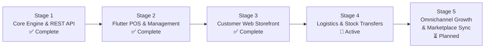
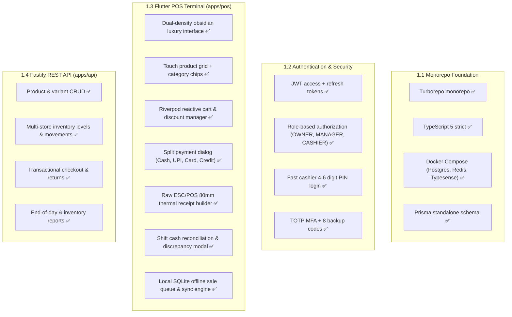
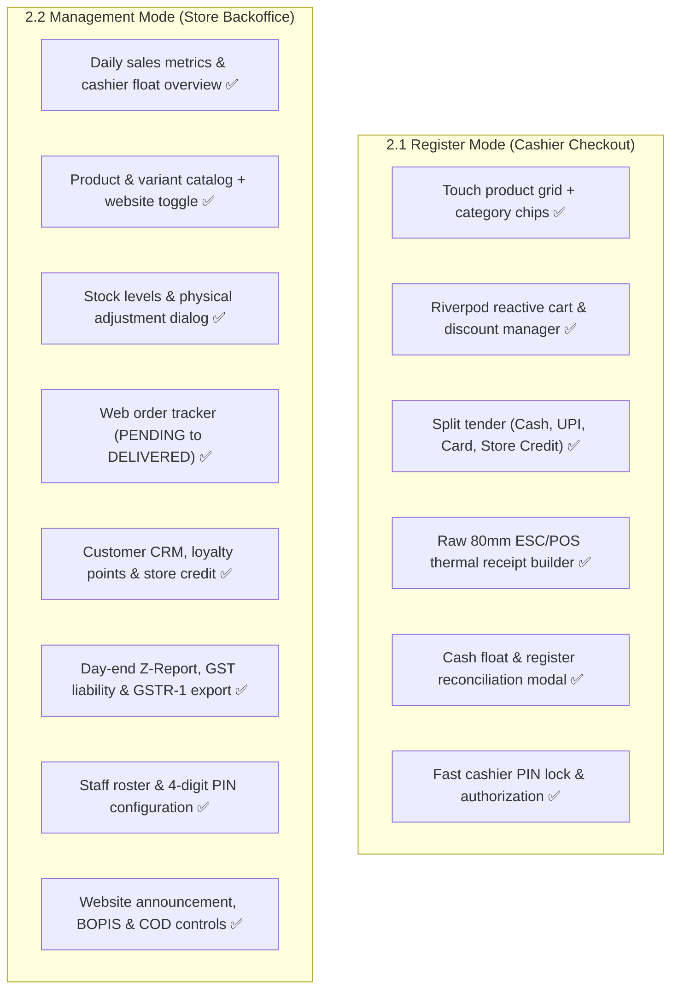
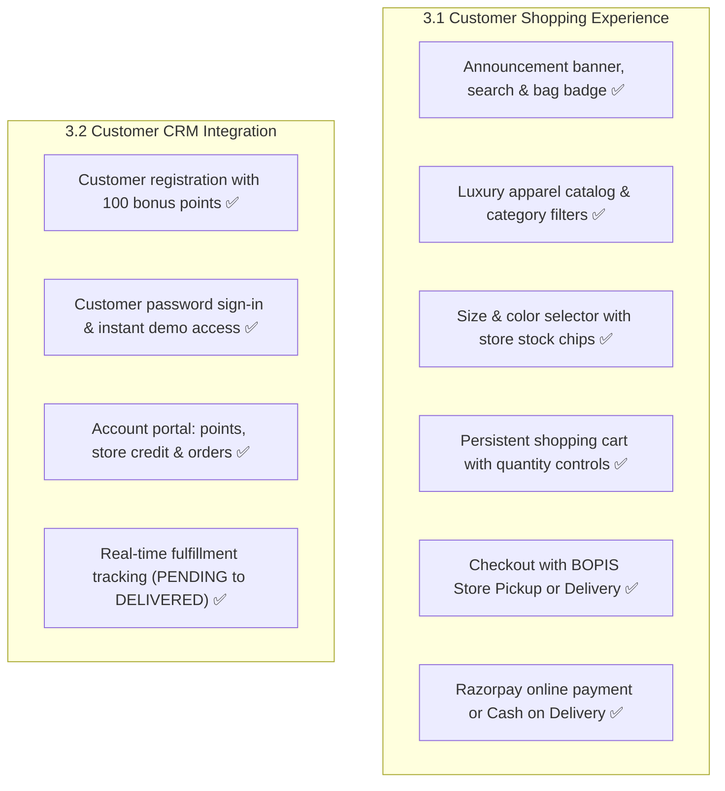
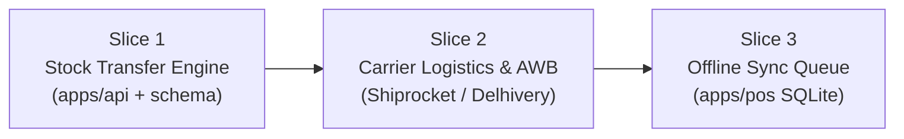

# Master Roadmap & Actionable TODOs

This document maintains the canonical status of all development stages and granular module TODOs for themrktplace Standalone Omnichannel Retail Suite.

---

## Stage Progression Overview

| Stage | Name | Target Capabilities | Status |
|---|---|---|---|
| **1** | Core Engine & REST API | Fastify REST API, PostgreSQL, Redis, Typesense, Standalone Schema | **100% Complete** |
| **2** | Flutter POS & Management Terminal | Dual-mode terminal: Register Mode (checkout, printer, shifts) and Management Mode (catalog, inventory, web orders, CRM, reports, settings) | **100% Complete** |
| **3** | Customer Web Storefront | Next.js 14 luxury apparel storefront, customer auth, account portal, bag, BOPIS and courier checkout | **100% Complete** |
| **4** | Logistics, Transfers & Carrier Sync | Store-to-store stock transfers, Shiprocket AWB generation, automated SMS/WhatsApp alerts | **Active Development** |
| **5** | Omnichannel Growth & Marketplace Sync | Amazon, Flipkart, Myntra catalog sync, WhatsApp Commerce bot | **Planned** |

---

## Stage 1: Core Engine & Flutter POS Terminal (Complete)

### Completion Summary

### Detailed Checklist
- [x] Turborepo monorepo with apps (`api`, `storefront`, `pos`) and packages (`schema`, `ui`, `types`). Web admin dashboard consolidated into `apps/pos`.
- [x] Standalone Prisma schema with PostgreSQL 16 (removed all `tenantId` columns and multi-tenant overhead).
- [x] Docker Compose for local development (PostgreSQL, Redis, Typesense).
- [x] Fastify v4 API with JWT auth, rate limiting, and BullMQ worker queue.
- [x] Apparel variant matrix (Size, Color, SKU, Barcode, Cost, Selling Price).
- [x] Multi-store inventory levels and append-only inventory movement audit trail.
- [x] Split payment billing engine (Cash, Card, UPI, Store Credit, Loyalty Points).
- [x] Native Flutter cross-platform POS application (`apps/pos`) for Android, iOS, Windows, and macOS.
- [x] Touch-optimized product grid with live stock status chips and barcode search.
- [x] Raw ESC/POS thermal printing byte stream builder (80mm) with paper cut and cash drawer kick.
- [x] Cashier register shift opening and closing with cash denomination count and discrepancy tracking.
- [x] Customer CRM with loyalty points calculation and store credit balance management.

---

## Stage 2: Flutter POS & Operations Management (Complete)

All store, catalog, customer, and website management has been unified into the native Flutter POS terminal (`apps/pos`), eliminating the need for a separate browser admin dashboard.

### Module Progress

### Detailed Checklist

#### 2.1 Register Mode
- [x] Dual-density luxury Obsidian UI for compact touchscreens and wide desktop terminals.
- [x] Touch-optimized product grid with category chips and live stock indicators.
- [x] Riverpod reactive cart state with line item discounts and customer tagging.
- [x] Split tender payment modal supporting Cash, UPI QR, Card, and Store Credit.
- [x] Raw ESC/POS thermal printer byte stream generator for 80mm receipts.
- [x] Cashier shift opening, closing, cash denomination counting, and discrepancy logging.
- [x] Cashier PIN lock screen for rapid cashier handoffs.

#### 2.2 Management Mode (Unified Backoffice in POS)
- [x] Store Overview view with today's revenue, active online orders, and cashier float status.
- [x] Product Catalog view with apparel variant matrix and publish-to-website switch.
- [x] Inventory Management view with stock count by store, low-stock flags, and adjustment dialog.
- [x] Website Orders view for omnichannel order fulfillment (`PENDING`, `PACKED`, `SHIPPED`, `DELIVERED`).
- [x] Customer CRM view with purchase history, loyalty point rewards, and store credit balance.
- [x] Reports view with EOD Z-Report, GST tax liability, tender breakdown, and GSTR-1 export.
- [x] Staff Management view with staff roster, roles (`OWNER`, `MANAGER`, `CASHIER`), and PIN setup.
- [x] Website Settings view with announcement banner editor, BOPIS toggle, and COD controls.

---

## Stage 3: Customer Web Storefront & Omnichannel (Complete)

The web application (`apps/storefront`) is strictly customer-facing. It handles public catalog browsing, customer accounts, and order placement with zero admin or merchant overhead.

### Module Progress

### Detailed Checklist

#### 3.1 Customer Storefront (apps/storefront)
- [x] Next.js 14 App Router customer shopping portal with shadcn/ui "radix-maia" variant.
- [x] Global header with live announcement banner, brand mark, category nav, and cart counter.
- [x] Apparel catalog homepage with faceted category filtering and live store availability indicators.
- [x] Persistent shopping bag powered by Zustand with quantity selectors and line item removal.
- [x] Delivery mode switcher: BOPIS (Free Store Pickup at Indiranagar Flagship) vs Courier Home Delivery.
- [x] Streamlined checkout flow with shipping address input, GST calculation, and payment selection.
- [x] Order confirmation view with tracking ID and omnichannel store routing.

#### 3.2 Customer Authentication & Loyalty Portal
- [x] Customer sign-in page with email/password authentication via Fastify `/api/v1/website/customer/login`.
- [x] Customer registration page with automatic 100 loyalty points welcome credit.
- [x] Dedicated Customer Account dashboard displaying loyalty points, store credit balance, and past orders.
- [x] Live fulfillment status tracking (`PENDING`, `PACKED`, `SHIPPED`, `DELIVERED`) synced with POS actions.

---

## Stage 4: Logistics, Stock Transfers & Carrier Sync (Active)

#### Detailed Checklist
- [ ] Store-to-store stock transfer manifests and in-transit tracking (`StockTransfer` model).
- [ ] Shiprocket / Delhivery courier API integration for automated AWB generation.
- [ ] Automated SMS and WhatsApp order tracking updates via MSG91 / Meta Cloud API.
- [ ] Barcode verification during web order packing inside the POS terminal.
- [ ] Self-serve customer return portal on website with store credit refund option.

---

## Stage 5: Omnichannel Growth & Marketplace Sync (Planned)

#### Detailed Checklist
- [ ] Two-way catalog and inventory synchronization with Amazon India, Flipkart, and Myntra.
- [ ] Meta Commerce Manager integration for Instagram and Facebook Shop catalogs.
- [ ] Interactive WhatsApp shopping bot for order status queries and automated reordering.
- [ ] Public developer REST API with API key authentication and OpenAPI specification.

---

## Immediate Next Slices

| Slice | Module | Description | Impact |
|---|---|---|---|
| **Slice 1** | Stock Transfer Engine | Add `StockTransfer` Prisma model and dispatch/receive workflow in POS | Enables seamless inventory balancing between warehouse and retail stores |
| **Slice 2** | Carrier Logistics & AWB | Integrate Shiprocket API for courier pickup and automated AWB generation | Speeds up online order dispatch directly from store floor |
| **Slice 3** | POS Offline Sync Queue | Persist offline checkout transactions to local SQLite and sync with retry worker | Guarantees continuous billing during internet interruptions |
